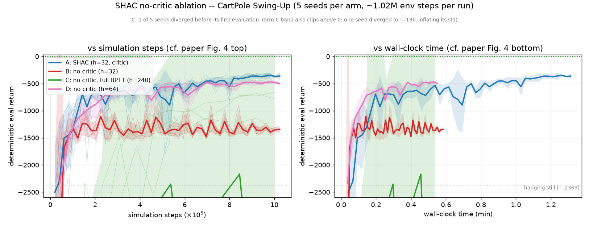
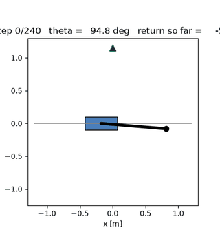
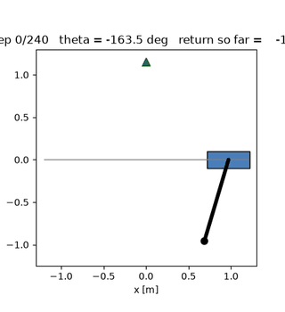
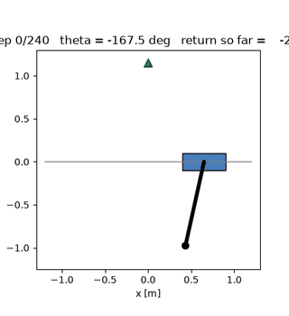
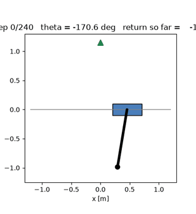

# Ablation: training SHAC without a critic

A companion document to the [README](README.md) — what the critic actually
contributes in SHAC, measured on CartPole Swing-Up (the paper's simplest
benchmark) with 5 seeds per arm at the paper's ~1.02M-step budget.

**TL;DR.** Remove the critic and keep only the pathwise-derivative window
reward of paper Eq. 5, and the actor still *swings the pole up* — but at the
paper's short horizon (h=32) it cannot *balance* it (wobbles at ~32° instead
of holding at ~3°). Doubling the window (h=64) buys the balance back but not
the baseline's swing-up speed. Stretching the window to the full episode
(h=240, pure BPTT) is unstable — one seed dies, one diverges. The critic's
measured price: ~2.25x the no-critic's wall-clock. Its measured value: the
full task return (−324.6 vs −442.4 best eval) and, at the paper's horizon,
far tighter seed consistency (±22 vs ±126).

---

## The question

SHAC's actor loss (paper Eq. 5) has two parts:

```
L_theta = -1/(N h) * sum_i [ sum_{t=t0}^{t0+h-1} gamma^{t-t0} R(s_t, a_t)    (a)
                              + gamma^h * V'(s_{t0+h}) ]                     (b)
```

(a) is the discounted short-horizon reward, computed by backpropagating
*through the differentiable simulator* — the pathwise-derivative part.
(b) is the target critic's value of the window's terminal state — the
bootstrap that stands in for everything beyond the window.

The paper's central design claim is that (a)+(b) with a SHORT horizon beats
long-horizon BPTT (part (a) alone with h = the full episode). This ablation
asks, on the simplest benchmark: **what exactly does (b) buy?** Performance,
behavior, compute, and stability — each measured separately.

## Method

### The switch

`SHACConfig.use_critic = False` (CLI: `--no-critic`) removes the critic, the
target critic, and their optimizer; the terminal value `nv` is identically
zero, so **both** bootstrap terms vanish — the window-end term `gamma^h V'`
and the mid-window term at task resets — and Eq. 5 degenerates to part (a)
alone: discounted short-horizon BPTT. The critic half of the training loop
(value targets, critic regression, target update — stages 3–5 of the
README's breakdown) is skipped entirely; `critic_loss` logs as an empty
CSV cell (identical schema across arms); checkpoints store `critic: None`.
Everything else — actor network, lr schedule, observation normalization,
grad clipping, seeds, evaluation — is untouched.

### Correctness guarantee

The ablated trainer is **bit-identical** to full SHAC whose target critic
outputs zero: `tests/test_no_critic.py` runs the same-seeded rollout through
both and requires identical actor losses *and* identical actor gradients,
including a window with mid-window task resets. So any arm difference below
is exactly the missing `V'` term — not an implementation side effect.

### Arms

All arms use the paper's CartPole configuration (N=64 parallel envs,
gamma=0.99, Table 4 lrs and networks), 5 seeds (0–4), and the same total
training budget of ~1.02M environment steps — the span of the CartPole
panel of the paper's Figure 4:

| arm | config | window h | episodes M | train env steps |
|---|---|---|---|---|
| **A** | SHAC baseline (paper Table 4) | 32 | 500 | 1,024,000 |
| **B** | `--no-critic` | 32 | 500 | 1,024,000 |
| **C** | `--no-critic --horizon 240 --episodes 67` | 240 | 67 | 1,029,120 |
| **D** | `--no-critic --horizon 64 --episodes 250` | 64 | 250 | 1,024,000 |

- **B** isolates the critic at the paper's horizon.
- **C** is the "just do full BPTT" alternative: the window *is* the whole
  240-step episode, so there is no myopia left — but the budget buys only 67
  gradient steps, each backpropagating through 240 simulator steps.
- **D** doubles the window at the same budget (250 updates).

Evaluation: 16 deterministic episodes (policy mean) on a separate
environment every 10 episodes (arm C: every 5 — it only has 67 episodes).
Deterministic evaluation episodes are *not* counted in the training budget.

### Preregistered hypotheses

- **H1** — the no-critic actor still learns to swing up (returns far above
  the hanging-still baseline of −2369).
- **H2** — its deficit is *balancing*, not swinging up.
- **H3** — no-critic training is cheaper: the paper's Table 12 attributes
  0.34 of SHAC's 0.72 s/episode (47%) to the critic stage, implying ≈1.9x.
- **H4** — no-critic training is less stable across seeds.

## A bug found and fixed during this work

While instrumenting the actor loss, a pre-existing broadcasting bug was
found in the per-env accumulator reset:

```python
rew_acc = torch.where(done.unsqueeze(-1), zeros, rew_acc)   # [N] -> [N, N] !!
```

`done` is `[N]`, so the reset silently broadcast the per-env return
accumulator to an `[N, N]` matrix. An instrumented replay reproduced the
committed baseline run's episode-1 actor loss exactly (1139.1942138671875 =
**64.00x** the correct Eq. 5 value 17.7999 — byte-identical to
`runs/cartpole_demo/log.csv`), proving every committed result had been
trained with it.

**Why it went unnoticed here — and why the old results are still valid.**
This task's only dones are synchronized time-limit resets (all 64 envs
finish together every 240 steps), so the broadcast degenerated to a *pure
constant x64 scale* on the actor loss in **every** window — done-free and
done-containing alike (probe ratios: 64.0000 on both a done-free window and
a 4-reset window). The gradient *direction* was always exact; only its
magnitude was 64x too big, which changes the effective step size only
through the grad-norm clip threshold (Adam is scale-invariant given the same
clipped gradient). Hence: different trajectories, statistically unchanged
quality — the old buggy single-seed runs scored −290.8 (500 episodes) and
−243.3 (3000 episodes) versus the fixed-code runs' −299.7 (seed 0) /
−324.6 ± 22.2 (5 seeds) and −236.5. On any task with *asynchronous* dones
(e.g. early termination) the same line fails loudly instead — a mixed done
set makes `rew_acc[done_ids]` shape-incompatible with the terminal-value term
and crashes — so it could never have produced silently-wrong results there.

The fix is one line (drop the `unsqueeze`), pinned by
`tests/test_actor_loss.py` (a naive per-env scalar reference for Eq. 5,
matching the vectorized loss to 6 decimals on done-free and multi-reset
windows). **Every run, figure, and GIF in this repository was regenerated
from fixed code**; no pre-fix artifacts remain.

## Results

### Training returns

Deterministic evaluation (16 episodes), best value seen during training and
the value at the last evaluation. Mean ± sd across the 5 seeds:

| arm | best eval | final eval | wall time* |
|---|---|---|---|
| **A** SHAC (h=32, critic) | **−324.6 ± 22.2** | −362.2 ± 48.9 | 78.8 s |
| **B** no critic (h=32) | −861.4 ± 125.6 | −1343.3 ± 40.7 | 35.0 s |
| **C** no critic, full BPTT (h=240) | −1673.9 ± 1707.5† | −4045.3 ± 6232.9† | 32.2 s |
| **D** no critic (h=64) | −442.4 ± 13.2 | −496.9 ± 33.4 | 33.0 s |

\* One CPU thread of a shared cluster node, full run including evaluations —
machine-dependent; the *ratios* are the meaningful numbers.
† Over the 4 surviving seeds; C's seed 2 died at episode 4 (non-finite actor
gradient norm) and has no evaluations. Per-seed detail:

| C seed | best eval | final eval |
|---|---|---|
| s0 | −4214.2 | −13383.7 (diverged) |
| s1 | −1135.0 | −1354.8 |
| s2 | *died at ep 4 — `RuntimeError: Non-finite actor gradient norm`* | |
| s3 | −683.9 | −780.4 |
| s4 | −662.5 | −662.5 |



Reading the curves (`scripts/plot_ablation.py`):

- **B swings up mid-training, then gets *worse*.** Every seed peaks between
  episodes 210–350 (bests −727…−1016) and then decays by 310–650 points to
  a tight −1343 ± 41 plateau. The myopic 32-step objective's optimum is not
  the task's optimum; optimizing it harder late in training moves the
  policy away from the true episode return.
- **C never approaches the baseline** — its best surviving seed (−662.5)
  is still 80% worse than A's final eval (−362.2) — and two of five seeds
  fail outright.
- **D is the most consistent arm of all** (best-eval sd ±13.2 vs A's ±22.2)
  and lands at −442: a large rescue from B's −861, still ~120 points short
  of A.

### What the policies do (behavior metrics)

Return alone can hide *how* a policy earns it.
`scripts/policy_metrics.py` runs 64 deterministic episodes from each best
checkpoint and measures the swing-up and the balance separately (success =
reaching |theta| < 0.25 rad and holding >= 10 steps; balance = mean |theta|
over the final 60 steps of the episode):

| arm | return | swing-up success | steps to upright | balance offset |
|---|---|---|---|---|
| **A** SHAC | −344.2 ± 38.0 | 100% | 63 | **3.0°** |
| **B** no critic (h=32) | −889.2 ± 125.7 | 84.7% | 121 | **32.0°** |
| **C** no critic (h=240) | −1632.3 ± 1594.0 | 74.2% | 84 (n=3) | 26.9° (n=3) |
| **D** no critic (h=64) | −505.3 ± 30.0 | 100% | 86 | **3.4°** |

(C per-seed: s0 never swings up — 0% success, return −4007; s1 100%/55.4°;
s3 96.9%/7.9°; s4 100%/17.3°. n=3 = the three seeds with any successful
episode.)

Rollouts of each arm's best policy (seed 0, deterministic, 0.83×
real-time) — the A/B contrast is the sharpest result, visible directly:
B arrives at the top and cannot hold it, D doubles the window and holds
it like A:

| **A** SHAC (h=32) | **B** no critic (h=32) | **C** no critic (h=240) | **D** no critic (h=64) |
|---|---|---|---|
|  |  |  |  |

This is the sharpest result of the ablation: **B reaches upright in 85% of
episodes but then wobbles at ~32° — it swings up but cannot balance.**
D doubles the window and the wobble disappears (3.4°, statistically A's
3.0°); what remains of D's return gap is the *swing-up transient* (86 vs 63
steps to upright, each step accumulating negative reward).

The timescales explain the split. At dt = 1/60 s the h=32 window carries
**0.53 s** of credit — and the pole's unstable mode near upright grows with
an e-folding time of ~0.27 s (linearizing this repo's URDF parameters:
sqrt(m g l / I_p) = sqrt(49.05 / 3.5) ≈ 3.7 s⁻¹). A 32-step window spans
barely two e-foldings, so near the top a state about to fall and a state
about to hold look nearly the same under the truncated objective — the
gradient signal for *stabilizing* corrections is weak (this is a plausible
mechanism, not a verified one). The h=64 window spans four e-foldings (1.07 s,
about 2/3 of the pendulum's 1.7 s period), and balance reappears.

### Compute cost

| arm | wall time | speedup vs A | eval episodes |
|---|---|---|---|
| A | 78.8 s | 1.00x | 50 |
| B | 35.0 s | **2.25x** | 50 |
| C | 32.2 s | 2.45x | 13 |
| D | 33.0 s | 2.39x | 25 |

A-vs-B is the clean comparison (identical eval schedules): **removing the
critic saves 2.25x end-to-end**, more than the ≈1.9x implied by the paper's
Table 12 profiling (47% of step time), because the critic stage here is 16
iterations x 4 minibatches of regression over all 2048 window transitions
per episode. C and D also run fewer evaluation episodes, which flatters
their raw wall times slightly beyond the algorithmic saving.

Wall-clock-to-threshold tells the same story: D first evaluates at −500 or
better after **12–24 s** of training (episodes 90–170); A needs 27–44 s
(episodes 170–280) — D reaches a "swings up and balances decently" policy
about twice as fast in wall time, while A reaches it in fewer environment
steps. (B and C never evaluate at −500 or better.)

### Stability

- **B: moderately less stable.** Best-eval sd ±125.6 is 5.6x A's ±22.2;
  the *final* evals are tight (±40.7) because all seeds converge to the same
  myopic plateau. No crashes.
- **C: catastrophically unstable.** One seed dead at episode 4 (non-finite
  gradients), one diverged to −13,384; best-eval sd ±1707.5.
- **D: the most consistent arm of all** (±13.2).
- Exploration noise (final policy std): A 0.065, B 0.064, D 0.140. B does
  *not* determinize harder than A — its plateau is a property of the
  objective, not of collapsed entropy. D keeps 2.2x A's exploration noise
  and still matches its balance.

### Verdicts

- **H1 — confirmed.** B rises from hanging (−2369) to −861 best / 84.7%
  swing-up success: the pathwise window reward alone discovers the
  energy-pump swing-up.
- **H2 — confirmed and refined.** B's deficit is balancing: it reaches
  upright in 85% of episodes, then holds at ~32° (vs A's 3.0°). Not a
  failure to swing up — a failure to *stay* up.
- **H3 — confirmed.** 2.25x end-to-end (A vs B, identical eval schedules),
  vs ≈1.9x implied by the paper's own profiling.
- **H4 — split.** At h=32 the no-critic arm is moderately less stable
  (±125.6 vs ±22.2 on best eval); at h=64 it is *more* consistent than the
  baseline (±13.2); at h=240 it is catastrophic (1 dead, 1 diverged). The
  instability tracks the **horizon**, not the missing critic per se.

## Interpretation

**What the critic is not needed for:** the swing-up itself. Every no-critic
arm that survived learns it (84.7–100% success) — the pathwise derivative
of the window reward contains enough signal to discover the energy pump,
even though the full swing takes longer than B's 32-step window (that's
what the continuing, on-policy windows accumulate over many updates).

**What it buys at h=32:** balance. The 0.53 s window cannot distinguish
"upright and about to fall" from "upright and holding", so B optimizes its
way to a 32° limit cycle that is locally optimal under the truncated
objective — and the peak-then-decay curve shows the objective's optimum
drifting away from the task's as training sharpens the policy.

**Why not just lengthen the window?** Two different walls:
- *h=64* recovers balance (3.4°) — the informative region now spans ~4
  e-foldings — but the transient return gap remains (86 vs 63 steps to
  upright): the swing-up takes ~86 steps > the 64-step window, so the fine
  speed optimization that A's critic enables is still partly invisible.
- *h=240* removes every myopia excuse — the derivative path covers the
  whole episode — and is exactly where training breaks: long-chain
  pathwise gradients explode (NaN at ep 4 in one seed, −13k divergence in
  another), and the fixed budget buys only 67 updates. This is the paper's
  own motivation for the short-horizon design, reproduced at the smallest
  scale.

**Net.** On this benchmark the ablation supports the paper's architecture
claim in its components: the pathwise derivative alone carries the swing-up
and (given a long-enough window) most of the balance, but the critic's
bootstrap is what supplies beyond-window credit *without* paying for long,
unstable backpropagation chains — which is precisely the trade Eq. 5(b)
makes. Remove it and the policy degrades exactly in the components whose
credit lies past the window.

## Reproducing

```bash
# arm A -- baseline (paper Table 4), then B / C / D, each x seeds 0..4
for s in 0 1 2 3 4; do
  uv run python -m shac.train --device cpu --threads 1 --seed $s \
      --logdir runs/ablation/a_shac_s$s
  uv run python -m shac.train --device cpu --threads 1 --seed $s --no-critic \
      --logdir runs/ablation/b_nocritic_s$s
  uv run python -m shac.train --device cpu --threads 1 --seed $s --no-critic \
      --horizon 240 --episodes 67 --eval-interval 5 \
      --logdir runs/ablation/c_bptt240_s$s
  uv run python -m shac.train --device cpu --threads 1 --seed $s --no-critic \
      --horizon 64 --episodes 250 \
      --logdir runs/ablation/d_h64_s$s
done

# overlay figure (the one embedded above)
uv run python scripts/plot_ablation.py            # -> figures/ablation_eval.png

# behavior metrics for the best checkpoints (JSON for aggregation)
uv run python scripts/policy_metrics.py 'runs/ablation/*/best_policy.pt' --json
```

The raw run logs live in `runs/ablation/` (gitignored, like all run output);
every number in the tables above is computed from those `log.csv` files and
from `runs/ablation/policy_metrics.jsonl`. The single training failure
(C seed 2) is recorded in `runs/ablation/failures.txt` and counted as a
finding, not swept away: it is one of the two instability observations
behind H4's split verdict.
