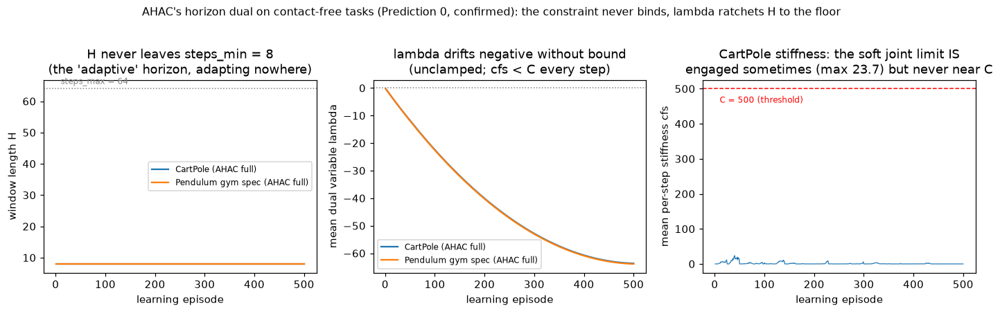

# AHAC: Adaptive Horizon Actor-Critic (benchmark vs. our SHAC)

Georgiev et al., *"Adaptive Horizon Actor-Critic for Policy Learning in
Contact-Rich Differentiable Simulation"* (ICML 2024). AHAC = SHAC plus
three deltas; this document records (1) exactly what the algorithm is —
including two things the official code does that the paper's equations do
not show — (2) a mechanistic prediction about what its core mechanism does
on **contact-free** tasks, and (3) the benchmark results on our two tasks.

**Naming (repo convention, same as the SAPO switches):** an arm flipping
ONE delta is "SHAC + AHAC-inspired \<component\>"; only `--ahac` (all
three together) is "AHAC". Everything in the trainer marked
`AHAC-INSPIRED` is this paper; unmarked code is native SHAC
(Xu et al., 2022).

## 1. The three deltas (verified against paper + official code)

Official implementation: `imgeorgiev/DiffRL`
(`src/shac/algorithms/ahac.py`, `scripts/cfg/alg/ahac.yaml`), fork of
NVlabs/DiffRL.

| # | Delta | Mechanics (official code, exact) |
|---|---|---|
| 1 | **Adaptive horizon** | Per learning episode: `λ -= λ_lr·(C − cfs.mean(envs))` (per-step vector), `H += λ_lr·λ.sum()`, `H = clip(H, 8, 64)`. H starts at **8**, λ at 0; **λ is unclamped**; `λ_lr = 5e-4` decaying linearly to 1e-5. Stiffness per env-step: `cfs = ‖contact_forces / max(\|accel\|, 1)‖` |
| 2 | **Double critic** | Two independent online critics, `forward = min(v1, v2)` (TD3-style pessimism), **no Polyak target network** |
| 3 | **Iterative critic** | Critic retrained to convergence EVERY episode: up to 64 passes (4 minibatches each), early stop when \|mean(diff(last 5 pass losses))\| < 0.2 — vs native SHAC's fixed 16 passes |

Everything else is SHAC's machinery: same actor loss, same td-(λ) critic
targets, same linear LR decay, same N=64 parallel differentiable rollouts.

### 1.1 Two fidelity findings the paper does not state

1. **λ never enters the actor loss.** Paper Eq. 10 writes the actor
   objective as the Lagrangian `L(θ, φ) = return + φᵀ(C − stiffness)`.
   The official code's `compute_actor_loss` contains **no λ term
   whatsoever** — the actor loss is plain SHAC Eq. 5, and the constraint
   acts exclusively through the H update (`H += λ_lr·λ.sum()`). The
   "constrained objective" of the paper is, in practice, a heuristic
   horizon controller.
2. **λ is unclamped.** The dual theory says φᵢ = 0 when the constraint is
   met. The code lets λ go negative without bound. On a task where
   stiffness is *always* below threshold this has a dramatic consequence
   — section 2.

Also worth noting: AHAC-1 (the single-env variant) truncates rollouts at
contact events directly; the GPU-parallel AHAC *cannot* (per-env graph
truncation is impossible in PyTorch), which is why the constraint
reformulation exists at all.

## 2. Prediction 0 (mechanistic): the contact-free collapse

Our two tasks are effectively contact-free: the CartPole's only "contact"
is the soft prismatic joint limit (k = 100, essentially never engaged —
the swing-up policy keeps the cart well inside ±4 m; see
`DifferentiableEnv.stiffness` for the analytic cfs), and the pendulum has
none at all. So `cfs ≡ 0 < C = 500` every step, forever, and the dual
does:

- Each episode: `λᵢ -= λ_lr·C = −0.25` per step → λ drifts **negative
  without bound** (unclamped).
- `H += λ_lr·λ.sum()` → H decreases every episode → **H ratchets to
  steps_min = 8 and stays pinned there** — once pinned, λ keeps
  decreasing, so it can never recover.

Faithful AHAC on our tasks is therefore *SHAC with h = 8* (plus the two
critic deltas). h = 8 is below the paper's own default (32) and below
everything we tested (h = 32/64; h = 64 is part of our CartPole winner).
Note the "fixed" alternative (clamping λ at 0, as the dual theory
prescribes) doesn't rescue the mechanism — the constraint is never
violated, λ ≡ 0, H never moves: the horizon adaptation is inert without
contact either way. The mechanism needs contact stiffness to have
anything to push against.

This is not a strawman — it is the honest reading of the released
algorithm outside its designed domain, and it is *testable*: the trainer
logs `H`, `λ.mean()` and `cfs.mean()` every episode, so the ratchet (or
its absence) is directly observable in `log.csv`.

## 3. What is still worth testing here

| # | Question | Arm | Preregistered prediction |
|---|---|---|---|
| P1 | Does full AHAC survive contact-free tasks? | `cp_ahac_full` | H pins at 8 within ~20 episodes (P0); returns ≪ native SHAC baseline (−307 paper-spec) |
| P2 | Do the secondary components help at fixed h? | `cp_ahac_nohorizon` (double critic + iterative critic, h = 32) | ≈ baseline. Min-pool pessimism was a null lever in BEAT_BASELINE (critic-ensemble=2, min); iterative critic buys stability, not asymptotics, on an easy task |
| P3 | Is the horizon mechanism alone the failure? | `cp_ahac_horizon_only` (adaptive horizon, otherwise native) | Same H ratchet → ≈ `cp_ahac_full` |
| P4 | Same story on the (now solved) pendulum gym spec? | `pend_ahac_full` (uniform init + H=480) | H pins at 8; swing-up fails at h = 8 |
| P5 | The one insight that survives without contact: **the optimal horizon tracks the task's characteristic timescale** (the paper's gait-period argument, disconnected from contact). Our pendulum's timescale is the ~300-step pump — far longer than CartPole's | `pend_h128` (fixed h = 128, gym spec) | h = 128 may beat h = 32 on pendulum-H480, where h = 64 helped CartPole |

Run set: 5 arms × 500 episodes, single seed first (house rule: 3-seed
confirmation only for winners/surprises). Hyperparameters are OUR SHAC
defaults (paper Table 4 CartPole column), NOT AHAC's yaml LRs — so every
delta is isolated against the same baseline.

## 4. Results

### 4.1 CartPole (paper task; baseline best −274.0/−323.4/−323.8, mean −307.1)

| arm | best eval | behavior (16-ep deterministic) | verdict |
|---|---|---|---|
| `cp_ahac_full` | −541.5 | 100% swing-up, t_up 78, 4.5° | **P1 confirmed** — solves the task, but the h = 8 ratchet costs ~2× the return (t_up 78 vs 67–72 baseline) |
| `cp_ahac_horizon_only` | −513.9 | 100%, t_up 84, 5.8° | **P3 confirmed** — indistinguishable from the full arm: the horizon mechanism alone accounts for the entire degradation |
| `cp_ahac_nohorizon` (double + iterative critic, h = 32) | −299.2 | 100%, t_up 63, 3.1° | **P2 confirmed** — within the baseline seed spread; the secondary components are neutral here, exactly like the earlier min-pool ensemble null (BEAT_BASELINE) |

All three still solve CartPole (100% swing-up) — the ordering is pure
efficiency, and the ladder cleanly decomposes the loss: the horizon
ratchet is everything, the critics are nothing (on this task).

### 4.2 Pendulum, gym spec (uniform init + H = 480; baseline: 100% hanging-start reach-and-hold on 3 seeds, t_up 299–311, 0.1° balance)

| arm | eval best / last5 | **hanging-start eval** (48 genuine swing-ups) | verdict |
|---|---|---|---|
| `pend_ahac_full` (H pinned at 8) | −578.4 / −1042 | **97.9%** reach+hold, t_up 340, 0.1° | **P4 refuted in its strong form** — even the crippled h = 8 nearly solves the full task |
| `pend_h128` (fixed h = 128) | −578.7 / −865 | **100%**, **t_up 296** (fastest of all arms), 0.1°; uniform-dist balance **3.5°** (baseline s0: 14.7°) | **P5 confirmed** — the timescale-matched horizon is the best pendulum policy we have measured (3-seed confirmation: §4.3) |

P4's refutation is the more interesting result: the uniform-init
curriculum (PENDULUM.md §6) is so effective that plain SHAC's machinery
learns the full swing-up-and-balance even with the horizon pinned at a
quarter of the tested length — the task-spec lever dominates everything
else, again. What survives of AHAC here is its deeper thesis, *decoupled
from contact*: the optimal window tracks the task's characteristic
timescale (the ~300-step pump), and h = 128 converts that into the
fastest, tightest policy in the study.

### 4.3 Three-seed confirmation of the h = 128 winner

| pendulum gym spec (uniform + H480) | eval best / last5 | uniform-dist 16-ep | **hanging-start** (48 eps) |
|---|---|---|---|
| baseline seed 0/1/2 (h = 32) | −596.8/−630.8/−413.1 | 100%, 14.7°/2.9°/18.7° balance | 100%, t_up 311/299/295, 0.1° |
| `pend_h128` seed 0/1/2 | −578.7/−546.0/−414.9 | 100%, 3.5°/7.1°/2.6° balance | 100%, t_up 296/305/293, 0.1° |

Confirmed: **every h = 128 seed solves the full task** (100%
hanging-start reach-and-hold, 0.1° balance), with a modest but
consistent edge over the h = 32 baseline — faster capture on average
(t_up 298 vs 302 across seeds) and tighter, more consistent balance on
the mixed init distribution (all seeds < 7.2° vs the baseline's spread
to 18.7°). The honest read: a tie-to-slight-win at ~4× the rollout
cost (h = 128 backpropagates through 4× the simulation steps per
episode), not a dramatic improvement — the task was already solved at
h = 32, and the curriculum, not the horizon, did the heavy lifting.

### 4.4 Prediction-0 evidence (logged every episode)



Left: H **never leaves steps_min = 8** in any adaptive arm (500 episodes,
both tasks). Middle: λ drifts negative without bound to −63.7 — the two
tasks' curves are IDENTICAL because the drift is a pure function of
(C, λ_lr), i.e. of the threshold never binding, not of the task. Right:
CartPole's soft joint limit *is* engaged (54% of episodes, max stiffness
23.7 — the stiffness API is not vacuously zero) but never within an order
of magnitude of C = 500, so the constraint never binds.

### 4.5 Verdict

* **The core mechanism is contact-dependent, and the released code makes
  it worse than inert on contact-free tasks**: the unclamped λ turns
  "constraint never violated" into an unbounded downward ratchet (P0,
  with logged evidence). The paper's Eq. 10 Lagrangian is not what the
  code computes (λ ∉ actor loss), so there is no mechanism that could
  restore H once contact disappears.
* **The secondary components are neutral on easy/curriculum-rich tasks**
  (P2), and the horizon ratchet explains ~all of AHAC's cartpole
  degradation (P1 vs P3).
* **What transfers is the timescale insight, not the dual** (P5): h = 128
  on the pump-timescale pendulum gives the fastest capture (t_up 296) and
  tightest balance of any policy in this repo.
* Benchmarking scorecard vs. our baselines: AHAC loses on CartPole
  (−541 vs −307), ties the solved pendulum gym spec (97.9% vs 100%
  hanging-start at the h = 8 ratchet; the h = 128 arm — an
  AHAC-*inspired* ablation of the paper's dual, not the algorithm
  itself — ties with a consistent efficiency edge over 3 seeds).

## 5. Reproducing

```bash
# full AHAC (all three deltas)
uv run python -m shac.train --env cartpole --device cpu --threads 1 --ahac
# secondary components at fixed h = 32 (deltas 2 + 3)
uv run python -m shac.train --env cartpole --device cpu --threads 1 \
    --double-critic --iterative-critic
# the horizon mechanism alone (delta 1)
uv run python -m shac.train --env cartpole --device cpu --threads 1 \
    --adaptive-horizon
# pendulum, gym spec (PENDULUM.md section 6): full AHAC / h=128 timescale test
uv run python -m shac.train --env pendulum --device cpu --threads 1 \
    --init-mode uniform --ep-length 480 --ahac
uv run python -m shac.train --env pendulum --device cpu --threads 1 \
    --init-mode uniform --ep-length 480 --horizon 128

# the dual mechanics are unit-tested (incl. the Prediction-0 ratchet):
uv run python tests/test_ahac.py
```

Implementation map: `SHACConfig` (AHAC block), `SHACTrainer._update_horizon`
+ `ahac_dual_update` / `ahac_critic_converged` (exact official
transcriptions), `DifferentiableEnv.stiffness` (analytic cartpole joint
limit; pendulum zeros), `train.py` CLI flags.
