# Experiment: the SAC/SAPO-style maximum-entropy objective

A companion document to the [README](README.md) — the natural third arm
of the [state-dependent σ(s) experiment](STATE_STD.md): SAC couples
σ(s) with an entropy bonus for a reason, so give SHAC the bonus too and
see if it beats the official global σ. Implemented the way SAPO (Xing,
Luk & Oh, ICLR 2025) instantiates SAC's objective inside a short-horizon
window, measured on CartPole Swing-Up at the paper's 500-episode
(~1.02M-step) budget.

**TL;DR.** The objective works mechanically EXACTLY as designed — the
temperature dual decays α 1.0 → 0.23 and parks the policy entropy at the
target Ĥ = −0.5, which floors σ at ≈ 0.15 (the equilibrium
h = −0.5 ⇔ σ ≈ 0.15 predicted in STATE_STD.md) and completely rescues
the state mode's exploration collapse (final window-mean σ(s): 0.0006
→ 0.142). But it does NOT beat the plain global σ at this budget:
best eval **−308.6** (state σ(s) + entropy) and **−314.3** (global σ +
entropy) vs **−274.0** (plain SHAC). At the paper's CartPole budget the
entropy insurance premium costs more than it pays. Verdict: keep the
official objective; the negative result bounds SAPO's scope rather than
contradicting it (their gains are on contact-rich/deformable tasks
where SHAC stalls in local minima — CartPole at 1.02M steps isn't
that). **Update:** the [pendulum follow-up](#the-pendulum-entropy-on-a-task-that-actually-stalls)
below then tested exactly that regime — a task where SHAC *does* stall
in a local optimum — and entropy still lost, narrowing the bound
further. The [raised-target cross-check](#raising-the-target-the-cross-task-dose-response-t--00)
adds a twist on the CartPole side: there, widening the target *helps*
(gap to plain 40 → 24 points), the opposite ordering from the pendulum —
the dose-response is a bet on how expensive exploration is per task.

---

## The question

STATE_STD.md ended with a diagnosis and a promise: σ(s) collapses
~100× harder than the global σ *because SHAC's loss has no entropy
term* — the counter-pressure that keeps SAC's state-dependent σ alive.
SAC's fix is the maximum-entropy objective: augment the return with
`α·H[π]` and auto-tune α to a target entropy. SAPO (ICLR 2025)
transplanted exactly this into SHAC and reports large gains on
differentiable-multiphysics tasks. So two hypotheses, preregistered
before running:

- **H1 (mechanism)** — the SAC dual holds the policy entropy at the
  target Ĥ = −dim(A)/2 = −0.5, which floors σ at the corresponding
  equilibrium width (≈ 0.15 for a 1-D tanh-Gaussian) instead of letting
  it decay/collapse.
- **H2 (the point of the experiment)** — with exploration kept alive,
  the entropy arm beats the plain global σ's best eval of −274.0 at the
  same budget.

H1 confirmed, precisely. H2 refuted: neither entropy arm comes within
34 points of the plain baseline.

## Method

### The switch

`SHACConfig.max_entropy = True` (CLI: `--max-entropy`) augments three
places, following SAPO's equations:

1. **Actor window return** (their Eq. 18-19): every window step's
   segment return carries `α·ĥ_t` in addition to the reward, with the
   same segmented-γ accumulation as the reward (the entropy term is a
   per-step scalar exactly like r_t, so it rides the identical
   γ/done machinery). The actor loss stays SHAC's FOBG window loss —
   the entropy enters through the same differentiable-simulation path.
2. **Critic TD-(λ) targets** (their Eq. 20): the recursion runs on
   `r + α·ĥ` — soft values. The critic then estimates the
   entropy-augmented return the actor optimizes.
3. **The α dual** (SAC Eq. 21, their Eq. 21): after each actor update,
   `α ← clamp₀₊(α − lr·(h − Ĥ))` on the window's mean raw entropy:
   below-target entropy raises α, above-target lowers it.

Design choices, all SAPO's unless noted:

- **Target Ĥ = −dim(A)/2 = −0.5** (SAC convention via Ball et al.
  2023; SAPO's choice).
- **Ĥ-normalized entropy in the losses** (their design choice II):
   ĥ = (h + |Ĥ|)/(2|Ĥ|) ≈ [0, 1], robust across reward scales. For
   CartPole's 1-D action 2|Ĥ| = 1, so ĥ = h + 0.5 — a constant shift
   that changes no actor gradient, only the (consistent) scale of the
   soft values. The dual sees the RAW h.
- **α init 1.0, entropy_lr 5e-3** (their Table 4), α clamped ≥ 0 so
   the bonus can never become a penalty.
- **Pre-dual α in the actor loss, post-dual α in the critic targets**
   (their pseudocode ordering).
- **SHAC's single critic + Polyak target kept** — this is SAPO-lite:
   their double-critic-without-targets (design choice IV) and
   SiLU/AdamW/clip changes (V) are NOT included, isolating the entropy
   objective itself.
- Works with BOTH σ parameterizations — the two experiment flags are
   orthogonal; `--state-std --max-entropy` covers choices I+II+III.
   NOTE: this is still NOT full SAPO — their choices IV (double critic,
   no targets, average pooling in the actor return) and V (SiLU/AdamW/
   clip-0.5) are separate; the complete faithful combination is the
   `cp_sapo_full` arm in [BEAT_BASELINE.md](BEAT_BASELINE.md).
- Checkpoints load across the flag (α is stored as a separate
   `entropy_alpha` field, restored by max-entropy trainers and ignored
   by plain ones); the CSV grows `entropy_alpha` (the pre-dual α that
   entered that episode's actor loss) and `policy_entropy` (the
   window-mean raw h) — always present, empty cells when disabled, so
   the schema is identical across all arms.

### The entropy estimator

`h = log σ + ½log(2πe) + log(1 − tanh²(u) + ε)` at the reparameterized
sample u — SAC's −log π with the zero-mean `½(ε²−1)` term replaced by
its expectation (unbiased, lower variance). Differentiable in μ (the
tanh correction pushes away from action saturation) and in σ (log σ)
inside the window's computation graph. **The MC pin in test 1 caught a
real sign error here during development**: the change of variables
gives log π(a) = log N(u) − log(1−tanh²(u)), so the correction enters
the entropy with a PLUS sign (squashing *reduces* entropy — a
saturating action is low-entropy). The wrong-sign version overstated h
by 2·E[−log(1−tanh²(u))] (≈ 0.5 nats at the runs' initial σ ≈ 0.37)
and would have reported more entropy than the policy actually had.

### Correctness guarantee

`tests/test_max_entropy.py` (5 tests, direct-run like the rest of the
suite) pins: the estimator against a 200k-sample Monte-Carlo of the
true squashed-Gaussian entropy (and the below-Gaussian, tiny-σ, and
saturation limits); the dual's direction (init entropy above target →
α decreases from 1.0; forced tiny σ → α increases; the ≥ 0 clamp) and
that the logged `entropy_alpha` is the pre-dual value; the actor-loss
wiring (same-RNG-state plain vs entropy windows produce bit-identical
rollouts, and the loss gap equals the accumulated entropy contribution
exactly, with the entropy term adding direct gradient onto σ); the
critic wiring (soft targets run on `r + α·ĥ` with the post-dual α,
spied via the `td_lambda_values` call); and the train-loop integration
(identical CSV schema across arms, α schedule in the log, checkpoint
α round-trip, and the `--state-std --max-entropy` coexistence).

### The arms

| arm | config | episodes | train env steps | wall time |
|---|---|---|---|---|
| **global** | SHAC baseline (paper settings) | 500 | 1,024,000 | 86 s |
| **state** | `--state-std` | 500 | 1,024,000 | 87 s |
| **global+ent** | `--max-entropy` | 500 | 1,024,000 | 88 s |
| **state+ent** | `--state-std --max-entropy` | 500 | 1,024,000 | 90 s |

The first two arms are the STATE_STD.md runs reused as-is; the last
two are new. Same seed (0), same hyperparameters, run sequentially on
the same machine. Single-seed first-look protocol, like STATE_STD.md
(not the 5-seed protocol of the [critic ablation](ABLATION.md)); the
entropy arms' gap to the baseline (34-40 points) is smaller than the
ablation's seed scatter, so per-seed claims would need the fuller
protocol — the sign of the result is what we preregistered against.

## Results

### Returns

| | global | state | global+ent | state+ent |
|---|---|---|---|---|
| best eval return | **−274.0** (ep 500) | −311.8 (ep 490) | −314.3 (ep 480) | −308.6 (ep 490) |
| final eval return | −274.0 | −354.4 | −328.1 | −348.5 |
| mean of last 5 evals | **−322.7** | −350.0 | −368.7 | −349.2 |
| first eval > −400 | ep 110 | ep 360 | ep 240 | ep 210 |
| evals ahead of plain global | — | — | 19/50 | 13/50 |

Rollouts of the 2×2's best policies (seed 0, deterministic, 0.83×
real-time — all four solve the task; the A/B is about training
exploration, not final behavior):

| global | state | global+ent | state+ent |
|---|---|---|---|
| 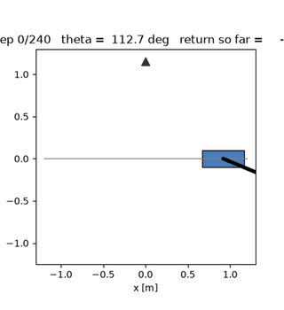 | 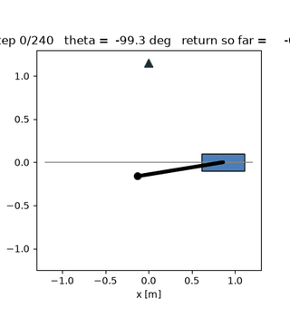 | 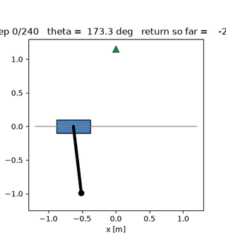 | 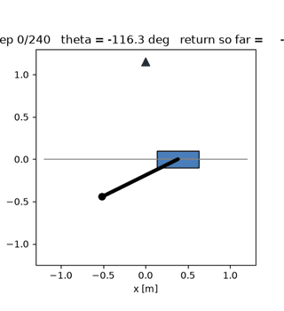 |

Reading the curves (figure panel a): the entropy arms are competitive
early — global+ent is ahead of the plain global at 19 of 50 evals —
but the plain global's steadily-annealing σ grinds past them after
~episode 300 and finishes 34-40 points clear. The entropy arms' bests
all cluster at episodes 480-500: every arm was still improving at the
budget end, so the comparison is "who extracts the most from 1.02M
steps", and the answer is the plain objective.

### The dual works (H1): α, H, and the σ floor

| | global+ent | state+ent |
|---|---|---|
| α at ep 50 / 250 / 500 | 0.834 / 0.392 / **0.243** | 0.890 / 0.402 / **0.228** |
| final window entropy h | **−0.46** | **−0.58** |
| final policy σ | 0.163 | 0.142 |
| final train return (last-10-ep mean, stochastic) | −421.5 | −386.8 |

The dual behaves exactly as SAC's theory says: the init policy's
entropy (window-mean +0.10 / +0.16 at episode 1) is well above the
−0.5 target, so α decays monotonically and the entropy is pulled down
onto the target (−0.46 / −0.58 final; figure panel c). And the σ
consequence is the headline
mechanism result: **h = −0.5 sits at σ ≈ 0.15 for a 1-D
tanh-Gaussian, and the dual pins σ exactly there** — global+ent ends
at 0.163, state+ent at 0.142 (figure panel b). No annealing, no
collapse: the state mode's 0.0006 death is fully rescued to 0.142, and
the global mode's slow 0.372 → 0.058 decay is replaced by a flat floor.

### Exploration kept alive ≠ better at this budget

The entropy arms reach −400 much earlier than their plain
counterparts (state: ep 360 → 210; global: ep 110 → 240 — the latter
is the one place the plain arm is *faster*), and the state+ent arm
does beat its plain state sibling (−308.6 vs −311.8): with the entropy
keeping σ(s) alive, the state mode finally gets modest value from its
per-state adaptivity — the pattern SAPO's ablations predict. But 3
points is noise-adjacent, and neither entropy arm touches the plain
global's −274.0.

### Gradient-estimator variance

| Var[∇̂] at ep 25 / 500 | global | state | global+ent | state+ent |
|---|---|---|---|---|
| | 51 / 3.3 | 974 / 43.7 | 83 / 35.0 | 152 / 76.9 |

The entropy arms sit between the plain arms — the σ(s) head's
pure-noise ε-path still dominates the state+ent arm's early variance,
while the entropy's direct log-σ gradient adds a modest amount to the
global arm. Not the deciding factor here.

### Raising the target: the cross-task dose-response (t = 0.0)

The [pendulum follow-up](#the-pendulum-entropy-on-a-task-that-actually-stalls)
below found target ↑ ⇒ worse, monotonically. The natural cross-check on
CartPole: two more arms at Ĥ = 0.0 (whose μ = 0 equilibrium is
σ ≈ 0.42, *above* the init 0.37, where −0.5 floors at 0.15). Not
preregistered — run after seeing the pendulum's monotone result, with
the pendulum prediction ("wider floor ⇒ worse") — **refuted**:

| arm | best eval (ep) | last 5 evals | σ end | α end | swing-up | t_up | balance |
|---|---|---|---|---|---|---|---|
| plain global | **−274.0** (500) | −322.7 ± 55 | 0.058 | — | 100% | 60 | 2.9° |
| plain state | −311.8 (490) | −350.0 ± 24 | 0.001 | — | 100% | 72 | 3.2° |
| global+ent t = −0.5 | −314.3 (480) | −368.7 ± 46 | 0.163 | 0.24 | 100% | 69 | 3.2° |
| global+ent t = 0.0 | **−298.5** (500) | −330.9 ± 28 | 0.290 | 0.82 | 100% | 71 | 3.2° |
| state+ent t = −0.5 | −308.6 (490) | −349.2 ± 26 | 0.142 | 0.23 | 100% | 65 | 2.7° |
| state+ent t = 0.0 | **−302.9** (440) | −362.4 ± 47 | 0.272 | 0.76 | 100% | 72 | 3.1° |

(`runs/ent_{global,state}_t00_500ep/`; behavioral metrics from
`scripts/policy_metrics.py`, 16 deterministic episodes per best
checkpoint.)

Rollouts of the two t = 0.0 arms' best policies (the four other arms'
rollouts are in the galleries above):

| global+ent t = 0.0 | state+ent t = 0.0 |
|---|---|
| 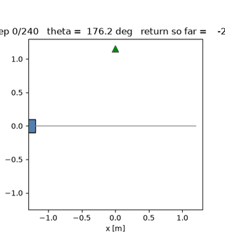 | 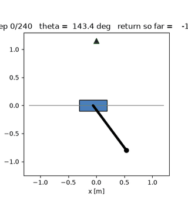 |

1. **All six arms solve CartPole** (100% swing-up, ~3° balance). The
   entropy dose changes the *speed*, never the *outcome*, on this task.
2. **The dose-response is task-dependent.** CartPole orders
   t = 0.0 > t = −0.5 on the global arm (best AND last-5) and on the
   state arm's best — the *opposite* of the pendulum's strict monotone.
   The divide is the price of noise: CartPole's reward has no action
   penalty and its 1000 N actuator never saturates, so noise is cheap;
   the pendulum's swing-up is a timing-critical maneuver that noise
   destroys.
3. **α settles at a genuinely different operating point**, not a
   rescaled one: t = 0.0 arms park at α ≈ 0.76–0.82 vs 0.23–0.24 at
   t = −0.5, with σ ending 0.27–0.29 vs 0.14–0.16.
4. **The headline conclusion survives but narrows**: the best entropy
   arm (−298.5) still trails plain global (−274.0), gap 40 → 24 points
   as the target widens. On CartPole the honest statement is "entropy
   still costs, but less the wider the target"; on the pendulum it is
   "entropy costs, and more the wider the target". Same objective, two
   tasks, opposite gradients — the target is not a hyperparameter with
   a universal sweet spot but a bet on how expensive exploration is on
   the task at hand.

### Verdict

At the paper budget on CartPole: **keep the official objective.** The
max-entropy machinery is correctly implemented (all five tests pin it),
does precisely what SAC's theory says, and rescues the σ(s) collapse —
but the plain global σ's naturally-annealing exploration is the better
budget fit for this task.

## Interpretation

Why does keeping exploration alive not pay here? Two mechanisms, both
visible in the numbers:

1. **The objective is genuinely different, and the eval measures only
   one side of it.** After the dual settles (α ≈ 0.23, ĥ ≈ 0.5), the
   actor maximizes return + ≈ 0.1/step of entropy bonus. Mid-swing
   (|r| ~ 5-15) that's a rounding error; balanced (|r| ~ 0.1-1) it is
   10-100% of the reward — so late in training the entropy arm is
   optimizing "stay a bit random" against "hold the pole", while the
   deterministic eval (μ only) grades only the pole. The final
   stochastic train returns make the same point from the other side:
   the entropy arms explore at σ ≈ 0.15 through the whole budget.
2. **This budget doesn't have an exploration problem left to solve.**
   The plain global reaches −400 by ep 110 and its σ anneals 0.372 →
   0.058 — an exploration schedule that happens to match the task's
   difficulty curve. The entropy floor replaces that schedule with a
   flat 0.15: more exploration exactly when the plain arm is starting
   to exploit. All four arms were still improving at ep 500, so the
   honest reading is not "entropy hurts the converged policy" but
   "entropy spends the 1.02M-step budget more slowly".

## Relation to SAPO

SAPO's wins are on tasks where SHAC's short-horizon training stalls in
local minima — contact-rich rigid-body locomotion (+6.8%) and the
deformable HandFlip (+172.7%, of which +69.7% from the non-entropy
design choices {III,IV,V} alone). Their critical ablation (b) shows
removing the entropy from the actor loss costs most of the gain *on
those tasks*. Nothing in our result contradicts that: CartPole
Swing-Up at the paper's 1.02M-step budget is the easy end of the
spectrum — the plain objective's remaining gap at ep 500 is a budget
gap, not a local-minimum gap, and entropy insurance that costs
~34 eval points buys nothing when there is no pathology to insure
against. What this experiment adds is the other side of SAPO's scope
boundary: at toy scale and budget, the SAC entropy term is a pure cost
— and their own rigid-body ablation points the same direction
({III,IV,V} without entropy: +0.5% on DFlex, i.e. also not where the
gain is).

## The pendulum: entropy on a task that actually stalls

The CartPole null above left SAPO's claimed regime untouched: their
gains are where SHAC *stalls in local minima*. The pendulum
([PENDULUM.md](PENDULUM.md)) is precisely such a task in this repo —
the plain objective plateaus at "swing through the top but never
capture it" (best eval −1376 ≈ 42% of the way from hanging-still −2369
to perfect 0), horizon-invariantly, with σ annealed 0.36 → 0.17 by the
time the top region is reached. If keeping exploration alive ever pays,
it should pay here.

**Preregistration.** Before running we measured the tanh-Gaussian
entropy↔σ mapping at μ = 0: the SAPO-default Ĥ = −0.5 corresponds to
σ ≈ 0.15, *below* the plateau's collapsed σ — the default arm could not
possibly inject exploration. So we crossed σ mode (global / state) with
target (−0.5 / **0.0**, flooring σ ≈ 0.42 > init 0.36), 500 episodes,
seed 0, all else identical to the pendulum baseline. Hypothesis: the
dual holds exploration wide enough that the top-region capture maneuver
gets sampled and reinforced.

| arm | best eval (ep) | last 5 evals | σ start → end | Ĥ end | swing-up |
|---|---|---|---|---|---|
| baseline (no entropy) | **−1376.0** (480) | −1455 ± 51 | 0.36 → 0.17 | — | **18.8%** |
| global, t = −0.5 | −1427.9 (420) | −1531 ± 69 | 0.37 → 0.64 | −0.46 | 0% |
| global, t = 0.0 | −1515.6 (480) | −1603 ± 60 | 0.37 → 0.72 | +0.02 | 0% |
| state, t = −0.5 | −1428.6 (290) | −1557 ± 66 | 0.37 → 0.64 | −0.55 | 0% |
| state, t = 0.0 | −1538.5 (290) | −1632 ± 53 | 0.37 → 0.70 | −0.03 | 0% |

(swing-up = fraction of deterministic-eval steps within 14° of upright;
0% means the best policy never reaches the top region at all.)

Rollouts of every arm's best policy — the orbit vs. capture contrast is
the whole story: the baseline passes through the top 18.8% of the time,
every entropy arm orbits below it (0%):

| baseline (no entropy) | global, t = −0.5 | global, t = 0.0 | state, t = −0.5 | state, t = 0.0 |
|---|---|---|---|---|
| 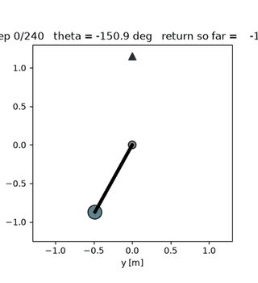 | 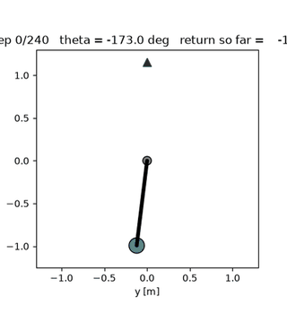 | 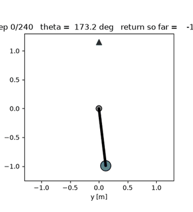 | 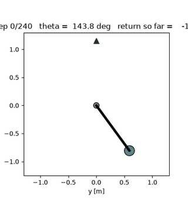 | 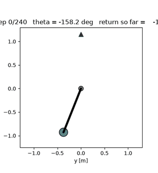 |

Three findings:

1. **The dual works; the target is enforced — but σ is not floored, it
   is INFLATED.** Unlike CartPole (dual pins σ ≈ 0.15), every arm's σ
   *grows* 0.37 → 0.64–0.72. The mechanism: the squashed-policy entropy
   is suppressed by the mean's distance from 0, and the reward parks the
   mean at large torques (mean |μ| ≈ 1.2, |tanh μ| ≈ 0.84, where
   log(1 − tanh²u) ≈ −1.2). At μ = 0, σ = 0.64 would give Ĥ ≈ +0.63;
   on-policy it is −0.46. The dual holds Ĥ at target by widening the
   base σ against the reward's pull.
2. **The inflation is fatal to the maneuver.** Swing-up here needs
   precisely timed alternating torques; σ ≈ 0.7 of action noise
   corrupts the timing, and every entropy arm's best policy scores 0%
   swing-up — strictly worse than the baseline's 18.8%. (The direct u²
   tax of the noise is small — the tanh Jacobian shrinks it where the
   mean is large; the cost is behavioral, not arithmetic.)
3. **More target = worse, monotonically.** t = 0.0 (wider floor) is
   uniformly worse than t = −0.5 on both σ modes. There is no dose at
   which the medicine helps in sight — and the CartPole cross-check
   above shows this is a property of *this task*, not of the objective:
   there the same comparison orders the *opposite* way.

**Scope conclusion.** This is the SAPO regime failing: a dense-reward
task where SHAC genuinely stalls in a local optimum, where entropy
insurance was supposed to pay — and it does not, because on this task
exploration is *expensive* (torque-limited 1-D action through a tanh;
noise taxes reward and destroys a timing-critical maneuver). SAPO's
wins remain plausible exactly where they were demonstrated —
contact-rich/deformable simulation with high-dimensional actions and
cheap noise — and this experiment removes the tempting middle case
"stalled low-dimensional swing-up" from their scope. Full details,
baseline diagnosis and open levers: [PENDULUM.md §5](PENDULUM.md).

## Reproducing

```bash
# the two new arms (sequential, same machine, ~90 s each); the plain
# arms are the STATE_STD.md runs (see that document's commands)
uv run python -m shac.train --logdir runs/std_ent_state_500ep --seed 0 \
    --episodes 500 --device cpu --threads 1 --state-std --max-entropy
uv run python -m shac.train --logdir runs/std_ent_global_500ep --seed 0 \
    --episodes 500 --device cpu --threads 1 --max-entropy

# the raised-target cross-check (dose-response section)
uv run python -m shac.train --logdir runs/ent_global_t00_500ep --seed 0 \
    --episodes 500 --device cpu --threads 1 --max-entropy --entropy-target 0.0
uv run python -m shac.train --logdir runs/ent_state_t00_500ep --seed 0 \
    --episodes 500 --device cpu --threads 1 --state-std --max-entropy --entropy-target 0.0

# the four-panel figure  -> figures/max_entropy_ab.png
uv run python scripts/plot_max_entropy.py

# per-run training figures
uv run python scripts/plot_training.py runs/std_ent_state_500ep
uv run python scripts/plot_training.py runs/std_ent_global_500ep

# ---- the pendulum follow-up (PENDULUM.md section 5.2) -----------------
# baseline first (the control), then the 2x2: {global, state} x {t=-0.5, 0.0}
uv run python -m shac.train --env pendulum --logdir runs/pendulum_20261109_155434 \
    --seed 0 --episodes 500 --device cpu --threads 1
for t in "" " --entropy-target 0.0"; do
  uv run python -m shac.train --env pendulum --seed 0 --episodes 500 --device cpu \
      --threads 1 --max-entropy $t --logdir "runs/pendulum_ent_global_t${t:-05}"
  uv run python -m shac.train --env pendulum --seed 0 --episodes 500 --device cpu \
      --threads 1 --state-std --max-entropy $t --logdir "runs/pendulum_ent_state_t${t:-05}"
done

# the five correctness tests
uv run python tests/test_max_entropy.py
```

Artifacts (gitignored `runs/`, regenerable above):
`runs/std_ent_state_500ep/`, `runs/std_ent_global_500ep/`,
`runs/ent_global_t00_500ep/`, `runs/ent_state_t00_500ep/` (log.csv,
checkpoints), the committed figure `figures/max_entropy_ab.png`.
