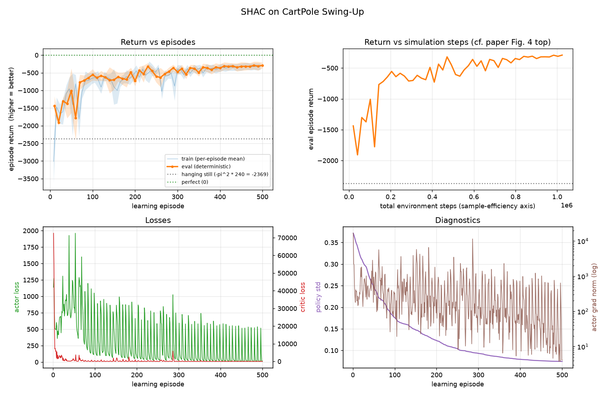
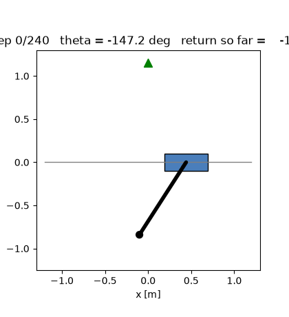
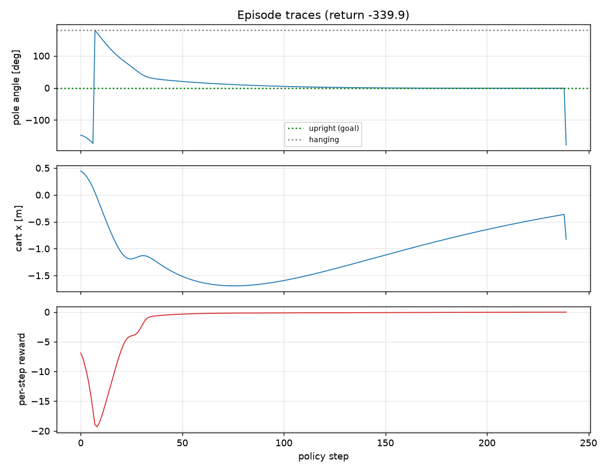
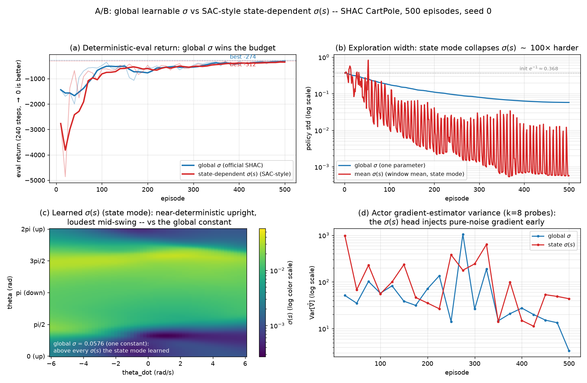
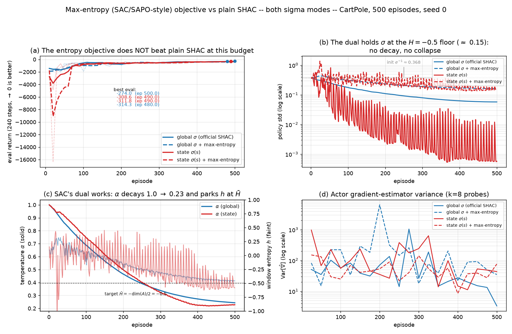

# SHAC — Short-Horizon Actor-Critic on CartPole Swing-Up

A small, self-contained, heavily-commented implementation of **SHAC**
(Short-Horizon Actor-Critic) from the ICLR 2022 paper
[*Accelerated Policy Learning with Parallel Differentiable Simulation*](https://short-horizon-actor-critic.github.io/)
(Xu et al.), applied to its simplest benchmark task, **CartPole Swing-Up**
(paper Appendix A.3.1).

Everything — including the *differentiable simulator* — is plain PyTorch, so
the code runs on **CPU or GPU** with no external simulation dependency, and
every file is written to be read top-to-bottom.

---

## Quickstart

The project is managed with [uv](https://docs.astral.sh/uv/): it creates the
virtual environment (`.venv/`), picks the interpreter pinned in
`.python-version` (downloading one if the machine has none), and installs
exactly the versions recorded in `uv.lock`. You never activate the venv or
call pip — `uv run <cmd>` ensures the environment is in sync and then runs
the command in it.

```bash
# one-time setup (CPU-only torch by default -- enough for CartPole)
uv sync

# run the tests first (physics + gradient + math checks)
uv run python tests/test_cartpole_dynamics.py
uv run python tests/test_td_lambda.py
uv run python tests/test_running_stats.py
uv run python tests/test_actor_loss.py
uv run python tests/test_no_critic.py
uv run python tests/test_grad_var.py
uv run python tests/test_state_std.py
uv run python tests/test_max_entropy.py

# train (CPU; ~2-5 minutes for the full 500 episodes on a laptop)
uv run python -m shac.train --device cpu

# train on GPU instead (identical code; see "CPU vs GPU" below for the
# one-line CUDA-torch switch in pyproject.toml)
uv run python -m shac.train --device cuda:0

# watch progress live in another terminal
tail -f runs/cartpole_*/log.csv

# visualize the training progression
uv run python scripts/plot_training.py runs/cartpole_<timestamp>   # -> training.png

# render the learned policy as an animation + trace plots
uv run python scripts/render_policy.py runs/cartpole_<timestamp>/best_policy.pt
#   -> best_policy_rollout.gif, best_policy_traces.png
```

(No `uv` yet? Install it with `curl -LsSf https://astral.sh/uv/install.sh | sh`.)

Useful training flags (defaults are the paper's CartPole settings):

```bash
uv run python -m shac.train \
    --device cpu \        # cpu | cuda | auto
    --threads 1 \         # CPU threads; tiny ops are fastest with 1-4
    --episodes 500 \      # M  (learning episodes)
    --num-envs 64 \       # N  (parallel environments)
    --horizon 32 \        # h  (short-horizon window length)
    --eval-interval 10    # deterministic evaluation every k episodes
```

### How to read the reward numbers

The CartPole reward `R = -theta^2 - 0.1*thd^2 - 0.05*x^2 - 0.1*xd^2` is always
**<= 0**, so the episode return (sum over the 240-step episode) is a negative
number that **approaches 0 as the policy gets better**:

| return (240 steps) | behavior |
|---|---|
| ~ **-2369** | pole hanging still (`-pi^2 * 240`) — do-nothing baseline |
| ~ **-1400 … -700** | pole swings up but doesn't hold balance |
| **> -300** | swings up and balances near upright |
| ~ **0** | perfect balance at `theta = 0, x = 0` |

(The paper's Figure 4 CartPole panel plots the *negated* return — a positive
"loss" that descends as training progresses. Same information.)

---

## Results (paper-budget 500-episode run)

A run with the paper's exact CartPole training budget — the Table 4
hyperparameters (seed 0, CPU only, `--threads 1`): **500 learning
episodes × 64 parallel environments × 32-step short-horizon windows =
1,024,000 environment steps**, the ~10⁶ total spanned by the CartPole
panel of the paper's Figure 4. On CPU this takes **80 seconds**; the
best evaluation return is **−300** (episode 430 of 500; the final-episode
evaluation is −315). The distance
to 0 is mostly the *swing-up transient itself*: every episode starts
with the pole hanging (−π), and the energetic swing-up costs a few
hundred return points before the near-zero-cost balance phase begins.

(For scale: the paper's Table 12 reports 0.72 s per learning episode on
a TITAN X — 0.15 s forward + 0.23 s backward + 0.34 s critic training —
so 500 episodes ≈ 6 minutes, exactly the extent of Figure 4's CartPole
wall-clock axis.)

> **Provenance note.** Every artifact in this section was regenerated
> after fixing a pre-existing broadcasting bug in the actor loss's
> per-env reset (found during the ablation work; see the bug note in
> [ABLATION.md](ABLATION.md)). The bug was a silent constant ×64 on the
> actor loss in this task, so the fix left the baseline statistically
> unchanged: seed 0's best evaluation moved from −291 to −300, and a
> 5-seed rerun of the same configuration gives −325 ± 22
> ([ABLATION.md](ABLATION.md), arm A).

**Training progression** (return vs simulation steps (×10⁵) and vs
wall-clock time — the two axes of the paper's Figure 4 — plus losses and
diagnostics, from `scripts/plot_training.py`; curves are smoothed — a
rolling mean for the returns, a rolling median for the spike-dominated
loss/gradient series — the single-seed counterpart of the paper's 5-seed
averaging; `--smooth 0` shows the raw per-episode values):



**Learned policy in action** (deterministic evaluation episode from
`scripts/render_policy.py`, rendered from the best checkpoint):



**Episode traces** (the same deterministic episode: pole angle from hanging
(±180°) to upright within the first ~40 steps, cart position, and per-step
reward — the pole is lost only in the episode's final steps, consistent
with the −340 return):



Training 6× longer (`--episodes 3000`, 6.1M steps, ~8 min on this CPU)
tightens the best evaluation return to **−236** (episode 2130 of 3000) —
the policy keeps improving well past the paper's 500-episode budget.

---

## Ablation: SHAC without a critic

What does the critic actually buy? [ABLATION.md](ABLATION.md) retrains
this exact baseline **without the critic** — keeping only the
pathwise-derivative window reward of paper Eq. 5 — at three horizons
(h = 32 / 64 / 240), 5 seeds per arm at the same ~1.02M-step budget, and
measures returns, behavior (swing-up success, time-to-upright, balance
offset), wall-clock cost, and seed stability. Short version: the
no-critic actor still swings up (85–100% success) but at h=32 cannot
balance (wobbles at ~32°); h=64 restores balance but not the baseline's
swing-up speed; full-episode BPTT at h=240 is unstable (1 of 5 seeds
dies, 1 diverges). Pass `--no-critic` to try it yourself.

---

## Experiment: SAC-style state-dependent σ(s)

The paper writes the stochastic policy as a ~ N(mu_theta(s), sigma_theta(s))
— a state-DEPENDENT standard deviation — but the official released code
uses a single GLOBAL learnable log-std. `--state-std` switches this repo
to the paper's parameterization, SAC-style: the actor head emits
[mu | log_std(s)] (clamped to [-20, 2] as in SAC), the log-std half is
zero-initialized so both variants start from the identical
sigma = exp(-1) ~= 0.368, and — since the SHAC loss has no
entropy/log-prob term — sigma(s) learns only through the reparameterized
noise path (dL/dsigma(s) = dL/du * eps).

A/B at the paper budget (500 episodes, seed 0, identical hyperparameters
and wall time, ~87 s each):

| | global σ (default) | state σ(s) (`--state-std`) |
|---|---|---|
| best eval return | **−274.0** | −311.8 |
| final policy std | 0.058 | 0.0006 (window mean) |
| first eval > −400 | episode 110 | episode 360 |
| grad-estimator Var (ep 25 / ep 500) | 51 / 3.3 | 974 / 43.7 |



Three findings:

1. **sigma(s) genuinely becomes state-dependent** — near-deterministic
   when balanced (3e-4), loudest mid-swing (0.036): a 132x spread over
   (theta, theta_dot), exactly the per-state adaptivity the paper's
   notation implies.
2. **But it collapses exploration ~100x harder than the global variant.**
   With no entropy bonus in the objective (the actual "SAC part" of
   SAC-style sigma(s)), the head races sigma(s) -> 0 state-by-state,
   premature convergence sets in, and the best return loses ~38 points
   at this budget.
3. **The sigma(s) parameters inject pure-noise gradient**: they receive
   gradient only through the eps-noise path, and the actor
   gradient-estimator variance is ~20x higher early (974 vs 51 at
   episode 25).

Verdict: at the paper budget on CartPole the official global sigma wins;
making sigma state-dependent without also adding SAC's max-entropy
objective removes exploration faster, not better. In this mode
`policy_std` logs the window-mean of sigma(s); checkpoints of the two
modes are not architecture-compatible (load with the same `--state-std`
flag). Tests: tests/test_state_std.py. The full write-up — the
clean-start A/B design, per-state sigma tables, the estimator-variance
cost, and how the result matches SAPO's ablations — is
[STATE_STD.md](STATE_STD.md). Pass `--state-std` to try it yourself.

---

## Experiment: SAC/SAPO-style max-entropy objective

The state-std A/B's diagnosis was that sigma collapses because SHAC's
loss has no entropy term — the counter-pressure SAC couples to
state-dependent sigma. `--max-entropy` adds it the way SAPO (ICLR
2025) instantiates SAC inside a short-horizon window: the actor's
segment returns carry `alpha * h_hat` per step, the critic's td-(lambda)
targets run on `r + alpha * h_hat` (soft values), and alpha is tuned by
SAC's dual toward a target entropy of `-dim(A)/2 = -0.5` (alpha init
1.0, clamped at 0; pre-dual alpha in the actor loss, post-dual in the
critic targets, SAPO's H-bar-normalized entropy in the losses, raw h
in the dual). Orthogonal to `--state-std`; checkpoints load across the
flag; the CSV grows `entropy_alpha` / `policy_entropy` (empty when off).

Four arms at the paper budget (500 episodes, seed 0, ~86-90 s each):

| | global σ | state σ(s) | global σ + ent | state σ(s) + ent |
|---|---|---|---|---|
| best eval return | **−274.0** | −311.8 | −314.3 | −308.6 |
| final policy std | 0.058 | 0.0006 | 0.163 | 0.142 |
| final alpha / entropy h | — | — | 0.243 / −0.46 | 0.228 / −0.58 |



The mechanism works exactly as SAC's theory says — alpha decays
1.0 → 0.23 and parks the policy entropy on the −0.5 target, which
floors sigma at ≈ 0.15 (the h = −0.5 equilibrium) and fully rescues
the state mode's 0.0006 collapse (→ 0.142). But it does not beat the
plain global sigma at this budget: the entropy arms' sustained
exploration is a tax the 1.02M-step budget never collects back, and
the plain objective finishes 34-40 points clear.

Verdict: at the paper budget on CartPole keep the official objective;
the negative result bounds SAPO's scope (their gains are on
contact-rich/deformable tasks where SHAC stalls in local minima)
rather than contradicting it. Tests: tests/test_max_entropy.py —
including the Monte-Carlo pin of the tanh-Gaussian entropy estimator
that caught a real sign error in the change-of-variables correction
during development. The full write-up — the wiring, the dual's α/H/σ
trajectories, the budget interpretation, and the SAPO relation — is
[MAX_ENTROPY.md](MAX_ENTROPY.md). Pass `--max-entropy` (optionally
`--entropy-target` / `--entropy-lr` / `--entropy-init-alpha`) to try
it yourself.

---

## Repository layout (suggested reading order)

```
pyproject.toml                   project + dependency declaration for uv
                                  (incl. the CPU/GPU torch switch)
uv.lock                          exact pinned versions -- commit this
.python-version                  the interpreter uv uses (3.12)
ABLATION.md                      the no-critic ablation write-up (4 arms
                                  x 5 seeds, ~1.02M steps each)
STATE_STD.md                     the state-dependent sigma A/B write-up
                                  (global vs SAC-style sigma(s), the
                                  exploration collapse, SAPO relation)
MAX_ENTROPY.md                   the max-entropy objective A/B write-up
                                  (SAC/SAPO-style soft returns + dual-
                                  tuned alpha, both sigma modes, the
                                  negative result and SAPO's scope)
MATH.md                          every formula implemented, in
                                  training-loop order (MDP, networks,
                                  actor/critic objectives, ablation)

shac/
├── config.py                    1. all hyperparameters, each annotated with
                                   its source (paper table / official config)
├── envs/
│   ├── base.py                  2. the DifferentiableEnv interface
│   │                               (step / reset / initialize_trajectory /
│   │                                save_state / load_state — the last two
│   │                                are the hooks a future MPC agent uses)
│   └── cartpole_swingup.py      3. the differentiable CartPole: equations of
│                                   motion derived in the docstring,
│                                   semi-implicit Euler, substeps, reward,
│                                   resets, joint limits
├── models/
│   └── networks.py              4. Gaussian actor (reparameterized) + critic
│                                   MLPs (ELU + LayerNorm, paper A.2.1)
├── algorithms/
│   └── shac.py                  5. ★ the algorithm — paper Algorithm 1,
│                                   Eq. 5-7, with every paper-vs-official-code
│                                   subtlety explained inline
├── utils/
│   ├── running_stats.py         6. running mean/var for observation
│                                   normalization (Chan et al. merge)
│   └── logger.py                7. CSV + JSON experiment logging
└── train.py                     8. CLI entry point (device selection,
                                   seeds, logging cadence)

tests/                           correctness of everything above
├── test_cartpole_dynamics.py    energy conservation, equilibria, ★ autograd
│                                Jacobians == finite differences (validates
│                                paper Eq. 1's backward pass), resets,
│                                end-to-end gradient flow
├── test_td_lambda.py            the vectorized td-(lambda) recursion == a
│                                naive literal implementation of paper Eq. 7
├── test_actor_loss.py           ★ the actor loss == a naive per-env scalar
│                                reference of paper Eq. 5 (done-free and
│                                multi-reset windows; regression test for
│                                the per-env reset bugfix)
├── test_no_critic.py            --no-critic == SHAC with a zeroed target
│                                critic, bit-for-bit; smoke run +
│                                checkpoint round-trip
├── test_grad_var.py             gradient-estimator variance diagnostic:
│                                purity, same-estimator, CSV schema
├── test_state_std.py            SAC-style state-dependent sigma(s): init
│                                equivalence, clamp bounds, gradient
│                                path, train integration, ckpt round-trip
├── test_max_entropy.py          SAC/SAPO-style max-entropy objective: MC
│                                pin of the tanh-Gaussian entropy estimator,
│                                dual direction/clamp, actor + critic
│                                wiring, CSV schema, ckpt alpha round-trip
└── test_running_stats.py        running statistics == batch statistics

scripts/
├── plot_training.py             learning curves from log.csv -> PNG
├── plot_ablation.py             5-seed arm overlay -> ablation_eval.png
│                                (see ABLATION.md)
├── plot_std_ab.py               the state-std A/B figure -> state_std_ab.png
│                                (see STATE_STD.md)
├── plot_max_entropy.py          the four-arm max-entropy figure ->
│                                max_entropy_ab.png (see MAX_ENTROPY.md)
├── policy_metrics.py             behavior of a trained checkpoint: swing-up
│                                success, time-to-upright, balance offset
└── render_policy.py             trained policy -> animated GIF + traces
```

★ = start here if you want the essence of the paper.

---

## The algorithm in five stages (what `SHACTrainer.train()` does each episode)

1. **Rollout (with gradients).** Sample N=64 trajectories of h=32 steps in
   parallel, *continuing* from the previous episode's end states but with the
   autograd graph **cut** (`initialize_trajectory()`). Actions come from a
   tanh-squashed reparameterized Gaussian.
2. **Actor update (Eq. 5).** Maximize the discounted short-horizon reward
   plus the target critic's value of the window's terminal state
   `gamma^h * V'(s_{t0+h})`. One Adam step; the gradient is computed by
   backpropagating *through the simulator* (that's the whole point of SHAC —
   Eq. 8-12 arise automatically from autograd).
3. **Value targets (Eq. 7).** Estimate a td-(lambda) target value for every
   state in the window (geometric mixture of k-step returns; `td_lambda_values`
   + its test).
4. **Critic update (Eq. 6).** Regress V onto the targets: 16 iterations x 4
   minibatches per learning episode.
5. **Target update.** `V' <- alpha*V' + (1-alpha)*V` with alpha = 0.2.

Every stage cites the paper equation it implements; the module docstring of
`shac/algorithms/shac.py` lists the details the paper leaves open and how the
official code (NVlabs/DiffRL) resolves them.

Passing `--no-critic` skips stages 3–5 entirely — the actor loss keeps only
the Eq. 5 window reward (no terminal bootstrap, no td-(lambda), no target
network). That ablation, with 5-seed results at three horizons, is written
up in [ABLATION.md](ABLATION.md).

---

## Hyperparameters (all defaults, from the paper + official config)

| parameter | value | source |
|---|---|---|
| short horizon h | 32 | paper Table 4 |
| parallel envs N | 64 | paper Table 4 |
| episodes M | 500 | paper Table 4 |
| task horizon H | 240 | paper A.3.1 |
| discount gamma | 0.99 | paper Table 4 |
| td-lambda | 0.95 | paper Table 4 |
| actor / critic lr | 1e-2 / 1e-3 (linear decay -> 1e-5) | Table 4 + official |
| Adam betas | (0.7, 0.95) | paper Table 4 |
| target alpha | 0.2 (CartPole; 0.995 is the paper's "general" setting) | Table 4/5 |
| critic iters x batches | 16 x 4 | paper Table 4 |
| grad-norm clip | 1.0 (both networks) | official config |
| obs normalization | running mean/std, frozen within each episode | paper §3.3 |
| networks | [64, 64] MLPs, ELU + LayerNorm | paper Table 1 |
| action | tanh(N(mu, sigma)), learnable log-std init -1 | official code |
| max-entropy (off by default) | target H = -dim(A)/2, alpha init 1.0, alpha lr 5e-3 | SAC / SAPO (see MAX_ENTROPY.md) |

---

## CPU vs GPU

The implementation is device-agnostic: the "parallel simulator" is just
batched tensor ops, so `--device cpu` and `--device cuda` run identical code.
For CartPole (N=64, h=32) **CPU is entirely adequate** — the compute per step
is tiny, and few CPU threads (`--threads 1..4`) are usually *faster* than
many (thread-pool contention dominates small ops). GPU becomes worthwhile
when you scale N up (thousands of parallel envs), which is the regime the
paper targets with its Warp-based simulator.

The **torch build** follows the same default: `uv sync` installs the
CPU-only wheel (small download, all CartPole needs). To train on a CUDA
machine, switch to the CUDA build first — it is a one-line edit in
`pyproject.toml` (see the *GPU SWITCH* note under `[tool.uv.sources]`):
comment out the `torch = { index = "pytorch-cpu" }` line, then run
`uv lock && uv sync`. Torch then comes from PyPI with the CUDA runtime
bundled (it also runs fine on CPU-only machines — it is just a much bigger
install). Switch back the same way.

---

## Fidelity notes (where this differs from the official implementation)

The official repo (NVlabs/DiffRL) uses a full GPU articulated-rigid-body
differentiable simulator (dflex/Warp). Here the CartPole dynamics are solved
analytically from the Euler-Lagrange equations with the **same physical
parameters as the official URDF** (cart 1 kg, pole 10 kg with COM at 0.5 m
and I_com = 1.0, force scale 1000 N, slider limits ±4 m, dt = 1/60 with 4
substeps) and integrated with the same semi-implicit Euler scheme. The
algorithm code follows the official `algorithms/shac.py` line-for-line in
semantics (discount resets, terminal-value handling, minibatching, lr decay,
grad clipping, frozen observation statistics per episode); deviations are
documented at the point of deviation. Consequently, learning curves should
qualitatively match the paper's Figure 4 CartPole panel (the paper's exact
numbers depend on their GPU nondeterminism anyway).

---

## MPC later?

Yes — and this code base is already shaped for it. CartPole swing-up is a
classic MPC benchmark task, and an MPC agent needs exactly what this repo
provides: a *differentiable* batched transition function `step()` plus
`save_state()/load_state()` to fork candidate rollouts from the current
state. Gradient-based shooting MPC is essentially "BPTT over an open-loop
action sequence" — the same machinery as SHAC's actor update, minus the
network; CEM/MPPI only need forward rolls (wrap `step()` in `no_grad`). The
`DifferentiableEnv` docstring spells out the intended integration points.

## Troubleshooting

* **Environment / uv**
  * `uv run` re-syncs `.venv/` from `uv.lock` automatically; if you ever
    end up with the wrong torch build (check
    `uv run python -c "import torch; print(torch.__version__)"` — the CPU
    build reports `2.x.y+cpu`), just run `uv sync` to restore the locked
    state.
  * The CUDA torch build needs a recent NVIDIA driver. If GPU training
    fails to see the device on an older cluster node, check
    `nvidia-smi` first.
* **`RuntimeError: Non-finite actor gradient norm`** — the simulation
  diverged (states -> NaN). This should not happen with the default
  config; check that you did not shrink the substeps/remove the tanh.
  It can also happen *genuinely* in long-horizon no-critic training —
  the ablation's arm C (h=240) lost 1 of 5 seeds to it (see
  [ABLATION.md](ABLATION.md)).
* **Learning stalls around -2400** — the critic needs a few episodes to
  warm up (the paper observes the same "slow start vs. PPO"); watch
  `eval_return_mean` around episode 30-100.
* **Want faster training?** Increase `--num-envs` (and move to GPU), or
  raise `--eval-interval` to evaluate less often.
