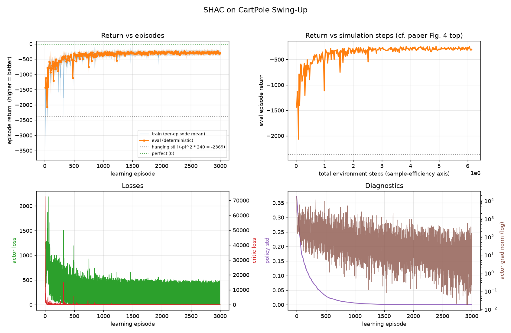
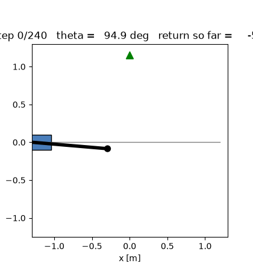

# SHAC — Short-Horizon Actor-Critic on CartPole Swing-Up

A small, self-contained, heavily-commented implementation of **SHAC**
(Short-Horizon Actor-Critic) from the ICLR 2022 paper
[*Accelerated Policy Learning with Parallel Differentiable Simulation*](https://short-horizon-actor-critic.github.io/)
(Xu et al.), applied to its simplest benchmark task, **CartPole Swing-Up**
(paper Appendix A.3.1).

Everything — including the *differentiable simulator* — is plain PyTorch, so
the code runs on **CPU or GPU** with no external simulation dependency, and
every file is written to be read top-to-bottom.

---

## Quickstart

The project is managed with [uv](https://docs.astral.sh/uv/): it creates the
virtual environment (`.venv/`), picks the interpreter pinned in
`.python-version` (downloading one if the machine has none), and installs
exactly the versions recorded in `uv.lock`. You never activate the venv or
call pip — `uv run <cmd>` ensures the environment is in sync and then runs
the command in it.

```bash
# one-time setup (CPU-only torch by default -- enough for CartPole)
uv sync

# run the tests first (physics + gradient + math checks)
uv run python tests/test_cartpole_dynamics.py
uv run python tests/test_td_lambda.py
uv run python tests/test_running_stats.py

# train (CPU; ~2-5 minutes for the full 500 episodes on a laptop)
uv run python -m shac.train --device cpu

# train on GPU instead (identical code; see "CPU vs GPU" below for the
# one-line CUDA-torch switch in pyproject.toml)
uv run python -m shac.train --device cuda:0

# watch progress live in another terminal
tail -f runs/cartpole_*/log.csv

# visualize the training progression
uv run python scripts/plot_training.py runs/cartpole_<timestamp>   # -> training.png

# render the learned policy as an animation + trace plots
uv run python scripts/render_policy.py runs/cartpole_<timestamp>/best_policy.pt
#   -> best_policy_rollout.gif, best_policy_traces.png
```

(No `uv` yet? Install it with `curl -LsSf https://astral.sh/uv/install.sh | sh`.)

Useful training flags (defaults are the paper's CartPole settings):

```bash
uv run python -m shac.train \
    --device cpu \        # cpu | cuda | auto
    --threads 1 \         # CPU threads; tiny ops are fastest with 1-4
    --episodes 500 \      # M  (learning episodes)
    --num-envs 64 \       # N  (parallel environments)
    --horizon 32 \        # h  (short-horizon window length)
    --eval-interval 10    # deterministic evaluation every k episodes
```

### How to read the reward numbers

The CartPole reward `R = -theta^2 - 0.1*thd^2 - 0.05*x^2 - 0.1*xd^2` is always
**<= 0**, so the episode return (sum over the 240-step episode) is a negative
number that **approaches 0 as the policy gets better**:

| return (240 steps) | behavior |
|---|---|
| ~ **-2369** | pole hanging still (`-pi^2 * 240`) — do-nothing baseline |
| ~ **-1400 … -700** | pole swings up but doesn't hold balance |
| **> -300** | swings up and balances near upright |
| ~ **0** | perfect balance at `theta = 0, x = 0` |

(The paper's Figure 4 CartPole panel plots the *negated* return — a positive
"loss" that descends as training progresses. Same information.)

---

## Results (3000-episode run)

A full run with the default paper hyperparameters (seed 0, CPU only,
`--threads 1`): 3000 learning episodes ≈ 6.1M environment steps in
**7.9 minutes**. The policy reliably swings up and balances from around
episode 600 onward (first evaluation above −300); the best evaluation
return is **−243** (episode 2390). The remaining distance to 0 is
mostly the *swing-up transient itself*: every episode starts with the pole
hanging (−π), and the energetic swing-up costs a few hundred return
points before the near-zero-cost balance phase begins.

**Training progression** (return vs episode / vs env steps, losses,
diagnostics — from `scripts/plot_training.py`):



**Learned policy in action** (deterministic evaluation episode from
`scripts/render_policy.py`, rendered from the best checkpoint):



---

## Repository layout (suggested reading order)

```
pyproject.toml                   project + dependency declaration for uv
                                  (incl. the CPU/GPU torch switch)
uv.lock                          exact pinned versions -- commit this
.python-version                  the interpreter uv uses (3.12)

shac/
├── config.py                    1. all hyperparameters, each annotated with
                                   its source (paper table / official config)
├── envs/
│   ├── base.py                  2. the DifferentiableEnv interface
│   │                               (step / reset / initialize_trajectory /
│   │                                save_state / load_state — the last two
│   │                                are the hooks a future MPC agent uses)
│   └── cartpole_swingup.py      3. the differentiable CartPole: equations of
│                                   motion derived in the docstring,
│                                   semi-implicit Euler, substeps, reward,
│                                   resets, joint limits
├── models/
│   └── networks.py              4. Gaussian actor (reparameterized) + critic
│                                   MLPs (ELU + LayerNorm, paper A.2.1)
├── algorithms/
│   └── shac.py                  5. ★ the algorithm — paper Algorithm 1,
│                                   Eq. 5-7, with every paper-vs-official-code
│                                   subtlety explained inline
├── utils/
│   ├── running_stats.py         6. running mean/var for observation
│                                   normalization (Chan et al. merge)
│   └── logger.py                7. CSV + JSON experiment logging
└── train.py                     8. CLI entry point (device selection,
                                   seeds, logging cadence)

tests/                           correctness of everything above
├── test_cartpole_dynamics.py    energy conservation, equilibria, ★ autograd
│                                Jacobians == finite differences (validates
│                                paper Eq. 1's backward pass), resets,
│                                end-to-end gradient flow
├── test_td_lambda.py            the vectorized td-(lambda) recursion == a
│                                naive literal implementation of paper Eq. 7
└── test_running_stats.py         running statistics == batch statistics

scripts/
├── plot_training.py             learning curves from log.csv -> PNG
└── render_policy.py             trained policy -> animated GIF + traces
```

★ = start here if you want the essence of the paper.

---

## The algorithm in five stages (what `SHACTrainer.train()` does each episode)

1. **Rollout (with gradients).** Sample N=64 trajectories of h=32 steps in
   parallel, *continuing* from the previous episode's end states but with the
   autograd graph **cut** (`initialize_trajectory()`). Actions come from a
   tanh-squashed reparameterized Gaussian.
2. **Actor update (Eq. 5).** Maximize the discounted short-horizon reward
   plus the target critic's value of the window's terminal state
   `gamma^h * V'(s_{t0+h})`. One Adam step; the gradient is computed by
   backpropagating *through the simulator* (that's the whole point of SHAC —
   Eq. 8-12 arise automatically from autograd).
3. **Value targets (Eq. 7).** Estimate a td-(lambda) target value for every
   state in the window (geometric mixture of k-step returns; `td_lambda_values`
   + its test).
4. **Critic update (Eq. 6).** Regress V onto the targets: 16 iterations x 4
   minibatches per learning episode.
5. **Target update.** `V' <- alpha*V' + (1-alpha)*V` with alpha = 0.2.

Every stage cites the paper equation it implements; the module docstring of
`shac/algorithms/shac.py` lists the details the paper leaves open and how the
official code (NVlabs/DiffRL) resolves them.

---

## Hyperparameters (all defaults, from the paper + official config)

| parameter | value | source |
|---|---|---|
| short horizon h | 32 | paper Table 4 |
| parallel envs N | 64 | paper Table 4 |
| episodes M | 500 | paper Table 4 |
| task horizon H | 240 | paper A.3.1 |
| discount gamma | 0.99 | paper Table 4 |
| td-lambda | 0.95 | paper Table 4 |
| actor / critic lr | 1e-2 / 1e-3 (linear decay -> 1e-5) | Table 4 + official |
| Adam betas | (0.7, 0.95) | paper Table 4 |
| target alpha | 0.2 (CartPole; 0.995 is the paper's "general" setting) | Table 4/5 |
| critic iters x batches | 16 x 4 | paper Table 4 |
| grad-norm clip | 1.0 (both networks) | official config |
| obs normalization | running mean/std, frozen within each episode | paper §3.3 |
| networks | [64, 64] MLPs, ELU + LayerNorm | paper Table 1 |
| action | tanh(N(mu, sigma)), learnable log-std init -1 | official code |

---

## CPU vs GPU

The implementation is device-agnostic: the "parallel simulator" is just
batched tensor ops, so `--device cpu` and `--device cuda` run identical code.
For CartPole (N=64, h=32) **CPU is entirely adequate** — the compute per step
is tiny, and few CPU threads (`--threads 1..4`) are usually *faster* than
many (thread-pool contention dominates small ops). GPU becomes worthwhile
when you scale N up (thousands of parallel envs), which is the regime the
paper targets with its Warp-based simulator.

The **torch build** follows the same default: `uv sync` installs the
CPU-only wheel (small download, all CartPole needs). To train on a CUDA
machine, switch to the CUDA build first — it is a one-line edit in
`pyproject.toml` (see the *GPU SWITCH* note under `[tool.uv.sources]`):
comment out the `torch = { index = "pytorch-cpu" }` line, then run
`uv lock && uv sync`. Torch then comes from PyPI with the CUDA runtime
bundled (it also runs fine on CPU-only machines — it is just a much bigger
install). Switch back the same way.

---

## Fidelity notes (where this differs from the official implementation)

The official repo (NVlabs/DiffRL) uses a full GPU articulated-rigid-body
differentiable simulator (dflex/Warp). Here the CartPole dynamics are solved
analytically from the Euler-Lagrange equations with the **same physical
parameters as the official URDF** (cart 1 kg, pole 10 kg with COM at 0.5 m
and I_com = 1.0, force scale 1000 N, slider limits ±4 m, dt = 1/60 with 4
substeps) and integrated with the same semi-implicit Euler scheme. The
algorithm code follows the official `algorithms/shac.py` line-for-line in
semantics (discount resets, terminal-value handling, minibatching, lr decay,
grad clipping, frozen observation statistics per episode); deviations are
documented at the point of deviation. Consequently, learning curves should
qualitatively match the paper's Figure 4 CartPole panel (the paper's exact
numbers depend on their GPU nondeterminism anyway).

---

## MPC later?

Yes — and this code base is already shaped for it. CartPole swing-up is a
classic MPC benchmark task, and an MPC agent needs exactly what this repo
provides: a *differentiable* batched transition function `step()` plus
`save_state()/load_state()` to fork candidate rollouts from the current
state. Gradient-based shooting MPC is essentially "BPTT over an open-loop
action sequence" — the same machinery as SHAC's actor update, minus the
network; CEM/MPPI only need forward rolls (wrap `step()` in `no_grad`). The
`DifferentiableEnv` docstring spells out the intended integration points.

## Troubleshooting

* **Environment / uv**
  * `uv run` re-syncs `.venv/` from `uv.lock` automatically; if you ever
    end up with the wrong torch build (check
    `uv run python -c "import torch; print(torch.__version__)"` — the CPU
    build reports `2.x.y+cpu`), just run `uv sync` to restore the locked
    state.
  * The CUDA torch build needs a recent NVIDIA driver. If GPU training
    fails to see the device on an older cluster node, check
    `nvidia-smi` first.
* **`RuntimeError: Non-finite actor gradient norm`** — the simulation
  diverged (states -> NaN). This should not happen with the default
  config; check that you did not shrink the substeps/remove the tanh.
* **Learning stalls around -2400** — the critic needs a few episodes to
  warm up (the paper observes the same "slow start vs. PPO"); watch
  `eval_return_mean` around episode 30-100.
* **Want faster training?** Increase `--num-envs` (and move to GPU), or
  raise `--eval-interval` to evaluate less often.
