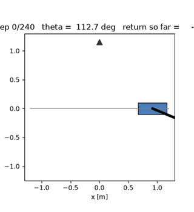
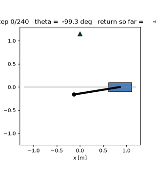

# Experiment: SAC-style state-dependent policy std

A companion document to the [README](README.md) — the paper's
`sigma_theta(s)` notation, implemented as an A/B against the official
released code's single global learnable `sigma`, measured on CartPole
Swing-Up at the paper's 500-episode (~1.02M-step) budget.

**TL;DR.** Giving the policy a state-dependent exploration width works
exactly as advertised — the learned `sigma(s)` is quiet when the pole is
balanced (3e-4) and loud mid-swing (0.036), a 132x spread across the state
grid. But *without* SAC's entropy objective (SHAC's loss has none), the
`sigma(s)` head races to zero state-by-state, exploration shuts down
~100x harder than the global variant, and the return loses ~38 points at
this budget: best eval **-274.0** (global) vs **-311.8** (state). The
official global sigma wins; the result independently reproduces, at
CartPole scale, the same finding SAPO's ablations report for rigid-body
tasks (see "Relation to SAPO" below).

---

## The question

The paper writes the stochastic policy as `a ~ N(mu_theta(s), sigma_theta(s))`
— a state-DEPENDENT standard deviation — but the official released code
(NVlabs/DiffRL, `ActorStochasticMLP`) uses a single GLOBAL learnable
log-std vector: one parameter per action dimension, the same at every
state.

What does the state-dependent parameterization actually buy, if the loss
is left untouched? Two hypotheses, preregistered before running:

- **H1** — `sigma(s)` becomes meaningfully state-dependent (the paper's
  notation is *implementable* and *used* by the gradient, not decorative).
- **H2** — because SHAC's actor loss has no entropy/log-prob term,
  `sigma(s)` learns only through the reparameterized noise path
  (`dL/dsigma(s) = dL/du * eps`), whose expected direction is
  `E_eps[L'(mu + sigma eps) * eps] = sigma * E[L''(u)]`: sigma shrinks
  wherever the short-horizon loss is locally convex in the action. With no
  entropy floor, a per-state head can chase that collapse further than a
  single global scalar — hurting exploration.

H1 confirmed, H2 confirmed — H2 is the whole story of this experiment.

## Method

### The switch

`SHACConfig.actor_state_std = True` (CLI: `--state-std`) switches the
actor from the official global log-std parameter to a SAC-style
state-dependent head: the MLP emits `[mu | log_std(s)]` (2 x action_dim
outputs), `log_std(s)` clamped to `[-20, 2]` as in SAC (Haarnoja et al.,
2018), `sigma(s) = exp(clamp(log_std(s)))`. Everything else — networks,
lr schedule, critic, TD-(lambda), observation normalization, grad
clipping, seeds, evaluation — is untouched. `policy_std` in the CSV
becomes the window-mean of `sigma(s)` (an accumulator on the actor,
reset at the start of every window, so gradient-probe windows and
deterministic evaluation never pollute it). Checkpoints of the two modes
are not architecture-compatible; `algo_cfg.actor_state_std` round-trips
through the checkpoint and `scripts/render_policy.py` /
`scripts/policy_metrics.py` rebuild the right actor from it.

### Clean-start equivalence (the A/B design)

The log-std half of the head is **zero-initialized** with bias
`actor_logstd_init`, so at initialization `log_std(s) == logstd_init`
EXACTLY at every state: both arms roll out their first episodes from the
identical `sigma = exp(-1) ~= 0.368` and differ only in whether sigma can
become state-dependent. (In global mode the logged `policy_std` reads
the parameter after that episode's Adam step, hence 0.3716 in row 1;
in state mode it is the pre-update window mean, hence exactly
`exp(-1)` — see `tests/test_state_std.py`.)

### Correctness guarantee

`tests/test_state_std.py` (5 tests, direct-run like the rest of the
suite) pins: the exact `sigma(s) = exp(logstd_init)` start and the
`deterministic=True == mu(s)` path; state dependence, determinism in s,
and both clamp bounds (including at the limits); that one real training
window puts nonzero gradient into the log-std half via the
reparameterization path AND that Adam moves it (with no entropy term
this is the only way `sigma(s)` can learn — the test would catch a
severed gradient path); the train-loop integration (first `policy_std`
exactly `exp(-1)`, later rows move, deterministic `evaluate()` never
feeds the accumulator, global mode regression); and the checkpoint
round-trip (`mu(s)`, `sigma(s)` bit-identical after save/load, the flag
in `algo_cfg`, and cross-mode loads failing on the shape mismatch).

### The arms

| arm | config | episodes | train env steps | wall time |
|---|---|---|---|---|
| **global** | SHAC baseline (paper settings) | 500 | 1,024,000 | 86.5 s |
| **state** | `--state-std` | 500 | 1,024,000 | 87.1 s |

Same seed (0), same hyperparameters (N=64, h=32, gamma=0.99, Table 4
networks and lrs), run sequentially on the same machine. Single-seed by
design: this is a first look, not the 5-seed protocol of the
[critic ablation](ABLATION.md); the sign and size of the gap below are
large relative to the ablation's seed scatter, but per-seed claims would
need the fuller protocol.

## Results

### Training returns

| | global sigma | state sigma(s) |
|---|---|---|
| best eval return | **-274.0** (ep 500) | -311.8 (ep 490) |
| final eval return | -274.0 | -354.4 |
| first eval > -400 | episode 110 | episode 360 |
| first eval > -300 | episode 480 | never |
| final policy std | 0.0576 | 0.0006 |
| grad-estimator Var, ep 25 / ep 500 | 51 / 3.3 | 974 / 43.7 |

The eval curves cross repeatedly — the state arm is intermittently
AHEAD mid-training (episodes 140–260, e.g. -427 vs -957 at ep 160) because
`sigma(s)` adapts exploration locally and fast — but after its collapse
(point below) it plateaus around -350..-450 while the global arm's
slowly-decaying sigma grinds on to -274. Raw curves and the four-panel
figure: `figures/state_std_ab.png`.

Rollouts of the two best policies (seed 0, deterministic — at eval the
sigma modes do not act, so both show the same solved swing-up; the A/B
differences live in the TRAINING exploration, not the final behavior):

| global sigma | state sigma(s) |
|---|---|
|  |  |

### Exploration width: the collapse

`policy_std` trajectories (log scale, figure panel b): the global
parameter decays smoothly 0.372 -> 0.058 over the whole budget. The state
mode's window-mean falls below 0.02 by episode 80 and thereafter
oscillates in the 0.001–0.06 range — ending ~100x below the global arm.

### What the learned sigma(s) looks like

From the best checkpoints, `sigma(s)` at canonical states (pole at rest /
in motion at the cart's center):

| state | global sigma | state sigma(s) |
|---|---|---|
| upright, at rest (theta=0) | 0.0576 | 0.00055 |
| upright, moving (theta_d=2) | 0.0576 | 0.00085 |
| horizontal, at rest (theta=pi/2) | 0.0576 | 0.00642 |
| horizontal, swinging (theta_d=-2) | 0.0576 | 0.01027 |
| hanging, at rest (theta=pi) | 0.0576 | 0.01308 |
| hanging, energetic (theta_d=-4) | 0.0576 | 0.01419 |

The structure is exactly what H1 predicted — near-deterministic when
balanced, noisier for swing-through states. Over the figure's
(theta, theta_dot) grid (121x61 states): min 0.00027, max 0.0357 — a
132x spread, loudest at theta=-1.3 rad mid-swing. But note the punchline:
the global arm's constant 0.0576 is ABOVE the state arm's maximum
(0.036). The state mode didn't redistribute a fixed exploration budget
— it ended up quieter than the global mode in EVERY state.

### Gradient-estimator variance

The `sigma(s)` head parameters receive gradient only through the
eps-noise path (`dL/dsigma(s) = dL/du * eps`) — pure-noise components
with no deterministic counterpart. The actor gradient-estimator variance
probe (`--grad-var-interval 25`, k=8) makes this visible: 974 vs 51 at
episode 25 (~20x), still 44 vs 3.3 at episode 500 (figure panel d).
This is the state mode's second structural cost: noisier actor updates
per sample, on top of the premature exploration shutdown.

### Verdict

At the paper budget on CartPole: **keep the official global sigma.**
`sigma(s)` is learnable, physically sensible, and cheap — but with no
entropy counter-pressure it removes exploration faster, not better.

## Interpretation

Why does the state mode collapse ~100x harder? Both arms face the same
expected push on sigma (`E[dL/dsigma] ~ sigma * E[L''(u)]`: shrink where
the window loss is locally convex in the action, grow where concave).
The global parameter sees this push averaged over all states and timesteps
— a mixture — and lands at a compromise (0.058) biased by the many
visited states where noise hurts. The state head can act state-by-state:
wherever a state's local curvature is convex it drives that state's
sigma toward its clamp floor, and most visited states qualify late in
training (the policy is close to its target behavior; noise mostly
hurts). Nothing in SHAC's objective pushes back — which is precisely the
role SAC's `-alpha * log pi` (maximum entropy) term plays, and the reason
SAC couples state-dependent sigma WITH an entropy bonus rather than
either alone.

## Relation to SAPO (ICLR 2025)

SAPO (Xing, Luk & Oh, "Stabilizing Reinforcement Learning in
Differentiable Multiphysics Simulation", ICLR 2025, arXiv:2412.12089) is
a maximum-entropy SHAC: the same short-horizon FOBG window with entropy
added to the return, a soft TD-(lambda) critic, and an auto-tuned
temperature alpha matching a target entropy of `-dim(A)/2`. Their
Section 4.2 design choice III is verbatim this experiment — "state-
dependent variance, with squashed Normal distribution
tanh(N(mu_theta(s), sigma^2_theta(s))), which aligns with SAC. In
contrast, SHAC uses state-independent variance."

This experiment is therefore choice III alone, and its result matches
their ablations from three directions:

1. **Same motivation.** SAPO's opening hypothesis: SHAC "is still prone
   to suboptimal convergence to local minima"; entropy stabilizes
   optimization over analytic gradients. Our observed state-by-state
   exploration shutdown is the same pathology seen from the exploration
   side.
2. **Their ablation (c)** — SHAC plus choices {III, IV, V} (state sigma
   + double critic without target networks + SiLU/AdamW/clip-0.5, i.e.
   strictly MORE than this experiment changes) — moves DFlex rigid-body
   locomotion by +0.5% on average (Table 14), while full SAPO gains
   +6.8%. On the deformable HandFlip it gains +69.7% of the +172.7%.
   Their critical ablation (b): removing the entropy term from the
   actor loss costs most of the gain (90 -> 59) — "using analytic
   gradients to train a policy to maximize both expected return and
   entropy is critical".
3. **The clamp floor.** SAPO's Table 4 clamps actor log-sigma to
   [-5, 2] — a sigma floor of ~0.0067. Our state run ended at
   window-mean 0.0006 with a grid minimum of 0.00028, i.e. BELOW their
   floor; their parameterization would not have permitted the collapse
   we measured, and their entropy term pushes the other way regardless.

So the honest summary of this experiment in SAPO's vocabulary: we built
"the SAC part" of SAPO without "the Soft part", and both our A/B and
their ablations agree that on rigid-body tasks that decomposition is not
where the gains are. The natural third arm — `--state-std` plus an
entropy-augmented window return (squashed-Gaussian entropy with the
tanh correction, soft TD-(lambda) targets, dual-tuned alpha with
target entropy -0.5 for our 1-D action) — would be a faithful CartPole
SAPO, and per their HandFlip ablation (w/o III: 90 -> 49) the
sigma(s) head matters once the entropy keeps it alive.

## Reproducing

```bash
# arm 1 -- baseline, then arm 2 (sequential, same machine, ~90 s each)
uv run python -m shac.train --logdir runs/std_global_500ep --seed 0 \
    --episodes 500 --device cpu --threads 1
uv run python -m shac.train --logdir runs/std_state_500ep --seed 0 \
    --episodes 500 --device cpu --threads 1 --state-std

# the four-panel A/B figure  -> figures/state_std_ab.png
uv run python scripts/plot_std_ab.py

# per-run training figures
uv run python scripts/plot_training.py runs/std_global_500ep
uv run python scripts/plot_training.py runs/std_state_500ep

# the five correctness tests
uv run python tests/test_state_std.py
```

Artifacts (gitignored `runs/`, regenerable above): `runs/std_global_500ep/`
and `runs/std_state_500ep/` (log.csv, checkpoints), the committed figure
`figures/state_std_ab.png`.
